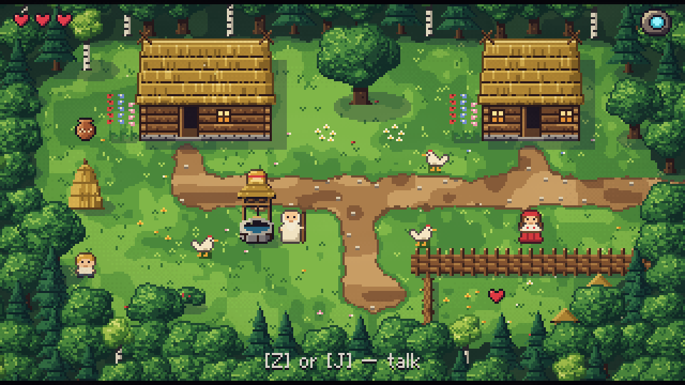
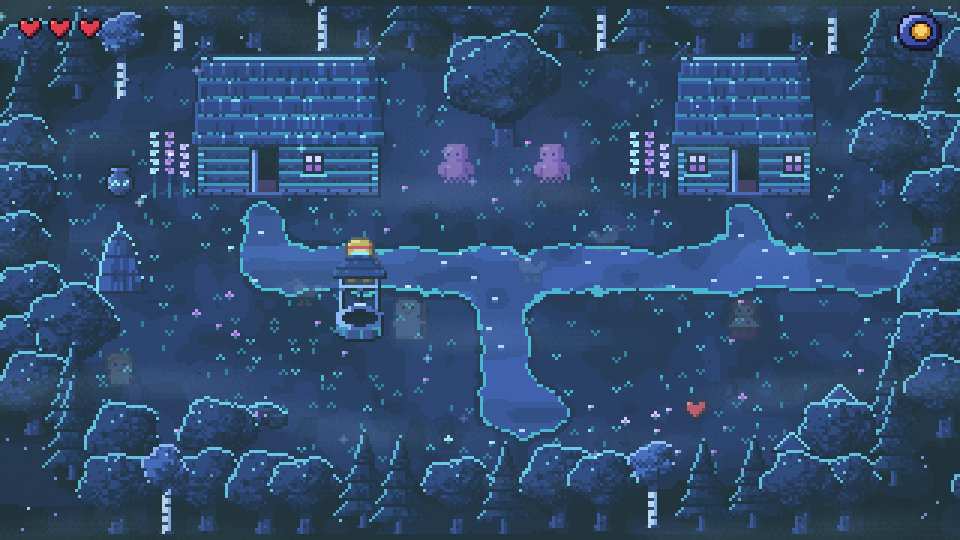
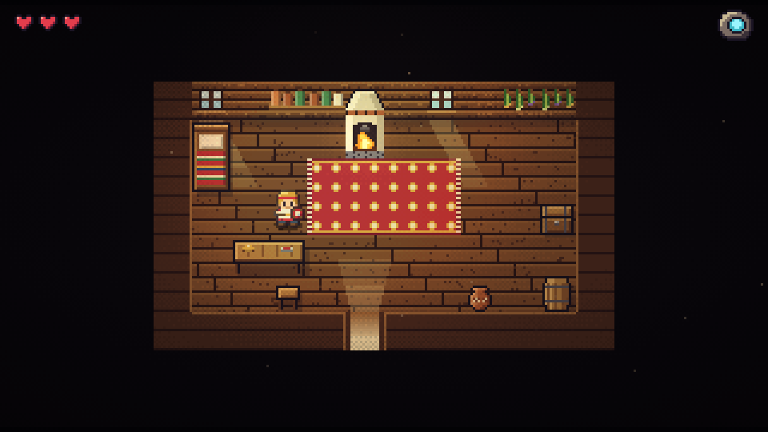
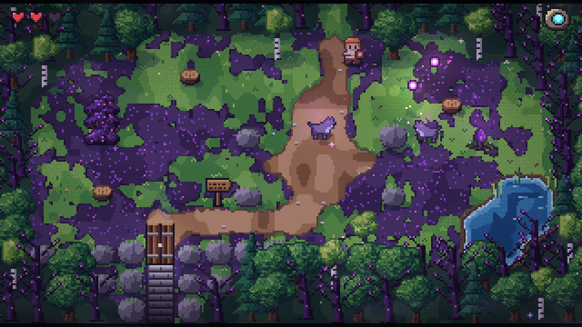

# NAWIA

A small top-down action adventure made for **GitHub Game Off 2026** (theme: **SHIFT**).

| Jawia: the world of the living | Nawia: the same place, as the dead remember it |
|---|---|
|  |  |
|  |  |

A village at the edge of the marshes. The bell of the drowned stronghold has been silent for years,
and the border between **Jawia** (the world of the living) and **Nawia** (the world of spirits) is cracking.
You carry a sword, a shield, and a hag stone set in the hilt. Turn it, and the world turns with it.

One button switches between two worlds laid over each other. The same room exists in both, but not the same way:
where rubble blocks the living, the dead remember an open corridor. A bridge stands only on one side.
Some things can only be hurt in the world they belong to.

The border forgives no mistakes: turn the stone where something stands on the other side and it throws you back
to where you entered the room, half a heart lighter. Nothing on screen shows you the other side.
Learn the room, then turn the stone.

> Status: playable demo, start to finish. Eighteen rooms: you wake up in your own house, in a cheerful village with hens
> in the yard and a dance tune playing; both houses can be entered. The forest beyond it darkens as the blight thickens
> towards the barrow (five surface rooms, painted per pixel, with tree crowns you can walk behind), and under the barrow lies
> the drowned stronghold (eleven rooms, one of them two screens wide).
> Both worlds everywhere, sword and shield, seven kinds of enemies, conversations with choices, a sun-and-moon switch puzzle,
> a memory room of invisible crossings, a boss that has to be fought in both worlds, and a bell at the end.
> All art, sound and music are generated in code.

## Documentation (in Polish)

- [docs/DEVELOPER.md](docs/DEVELOPER.md) – how the game is built and how to work on it: architecture, the two painters,
  the shift, entities, recipes for adding rooms, enemies, scenery and props.
- [docs/DESIGN.md](docs/DESIGN.md) – the game itself: world, mechanics, enemies, the route room by room.
- [docs/DIALOGS.md](docs/DIALOGS.md) – how to write conversations (plain text files, no code).
- [docs/ROOMS.md](docs/ROOMS.md) – the room file format and the full legend.
- [docs/ART.md](docs/ART.md) – art direction, sprite sheets, replacing generated art with PNGs.

## Who you meet

| | Lives in | What it does | What beats it |
|---|---|---|---|
| Utopiec (drowned one) | Jawia | wades in, crouches, lunges | the shield, then the sword |
| Zjawa (wraith) | Nawia | circles, then swoops straight through you; flies over the abyss | face it with the shield up |
| Ognik (wisp) | Jawia | hangs over water and spits fire | a raised shield sends its own fire back |
| Strzyga | both | has two souls: killed in Jawia, she gets up in Nawia | follow her across |
| Dzik (boar) | Jawia | paws the ground, then charges a long way | step aside; it stuns itself on walls and trees |
| Wilk (blighted wolf) | Jawia | circles, lunges, backs off | shield towards it, strike after the lunge |
| Morownik (blight bloom) | Jawia | rooted; opens and spits three thorns | close in between volleys; the shield stops thorns |
| The Guardian | the border | stone in Jawia, a heart in Nawia | make the stone charge into a wall, then strike the heart on the other side |

Every enemy warns before it strikes (it blinks white and shakes), then commits to a straight line.

## Controls

| | Keyboard | Gamepad |
|---|---|---|
| Move | WASD / arrows | left stick / d-pad |
| Turn the stone (shift worlds) | **Shift** or Space | Y, left bumper, left trigger |
| Strike | Z, J or Enter | A, X |
| Hold the shield | X or K | B, right bumper, right trigger |
| Talk (next to a villager), confirm an answer | Z, J or Enter | A |
| Pause | Esc / P | Start |
| Mute / Fullscreen / Language | M / F / L (title screen) | |
| Try the next hero design (while the look is being chosen) | H | |

Windows tip: pressing Shift five times in a row opens the Sticky Keys dialog. Space does the same thing in the game.

## Run it

Requires Node 22.18+ (developed on Node 24).

```bash
npm install
npm run dev        # http://localhost:5173
npm run build      # type-check + dungeon check + static build in dist/ (upload to itch.io as HTML5)
```

Handy while working:

```bash
npm run rooms:check    # can the game be finished? how many shifts does it take?
npm run art:export     # write all placeholder sheets as PNG into art-template/
npm run art:preview    # render tilesets, sprites and every room (both worlds) into art-template/preview/
```

Jump straight into a room while developing: `http://localhost:5173/?room=barrow&world=nawia`.

## How it is built

- **Phaser 4 + TypeScript + Vite**, static build, no backend.
- **Pixel perfect**: the game renders at 320x180 and is only ever enlarged by a whole number of device pixels.
- **Rooms are text files** (`src/world/rooms/*.room.txt`): one grid describes both worlds. See [docs/ROOMS.md](docs/ROOMS.md).
- **Two painters**: the stronghold is stamped from a tileset; the surface is painted per pixel from distance fields
  (rounded paths and shores), with trees, houses and fences stamped back to front and their tops drawn over the hero.
- **Sprite sheets are replaceable**: every sheet is a PNG-shaped grid. Drop a PNG with the same name into `assets/` and it
  replaces the generated one. See [docs/ART.md](docs/ART.md).
- **The shift** is instant in logic and a ring in pictures: both worlds of a room are pre-rendered, and a per-pixel
  ring composites one into the other (`src/fx/DualCanvas.ts`).
- **Light** is a CPU light map with dithered bands, multiplied over the scene (`src/fx/Lighting.ts`).
- **Sound and music** are synthesized with WebAudio (`src/audio/audio.ts`): no audio files. The surface tunes are two lines
  of notes each, played by a small step sequencer.
- **Conversations** are plain text files (`src/story/*.dialog.txt`) with answers to pick, jumps and things remembered.
- Feel tuning lives in one place: `TUNE` in `src/config.ts` (the hero, the shift and its penalty, the boss).
  Enemy behaviour numbers are the `SPECS` table at the top of `src/entities/Enemy.ts`.

```
src/
  config.ts          resolution, tuning
  core/              pixel buffer, input (keyboard + gamepad), rng
  art/               palettes, tiles, actors (16x16, on the grid), props, surface stamps, font, title picture (all drawn in code)
  world/             room format + parser, the two room painters, collision, rooms/*.room.txt
  entities/          Player, Enemy, Boss, Shot, Prop
  fx/                DualCanvas (the ring), Lighting, particles
  ui/                pixel text, HUD
  scenes/            Boot, Title (+ intro), Game, End
tools/               PNG export, previews, dungeon check
```

## Deploy

`.github/workflows/deploy.yml` builds on every push to `main`. To also publish to itch.io, add to the repository:

- secret `BUTLER_API_KEY` (itch.io -> Settings -> API keys),
- variable `ITCH_TARGET`, e.g. `your-user/nawia`.

The build is pushed to the `html5` channel. On itch.io set the project to "HTML", viewport 960x540 (or any multiple of 320x180),
and enable the fullscreen button.
