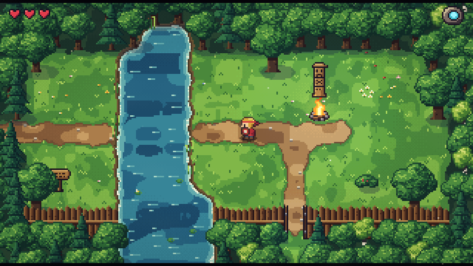

# Grafika: kierunek, technika i podmiana na PNG

Cała grafika powstaje w kodzie (`src/art/`). Nie ma ani jednego pliku graficznego w repozytorium poza ikoną strony.

> **Styl postaci jest w trakcie wyboru.** Gra używa dziś starszych, ręcznie rysowanych sprite'ów 16×16.
> Na placu prób ([PLAYGROUND.md](PLAYGROUND.md)) stoją postaci w docelowym rzemiośle: szerokość jednego kafla, wysokość jednego
> albo półtora, 15 kolorów na postać, jeden ciemny kontur, głowy rysowane ręcznie; potwory mają od jednego do dwóch kafli.
> To, co poniżej o postaciach 16×16, opisuje stan gry, nie stan docelowy.

## Kierunek

- **Jawia – tu i teraz.** Na powierzchni jasny poranek: światło pada z lewej góry, wszystko rzuca cień w prawo w dół.
  Pod ziemią mokra, ciężka ruina: ciepły kamień, mech, ogień. Powierzchnie są jasne, szczeliny między nimi ciemne.
- **Nawia – świat duchów.** To samo miejsce, jakim pamiętają je umarli: granatowe powierzchnie, a **krawędzie i szczeliny świecą**.
  Poza światem nie ma ziemi, tylko gwiazdy (poza murami grodu, w głębi lasu, w miejscu wody).
  Dusze i zjawy są fioletowe, żeby nie zlewały się z cyjanem otoczenia.
- **Ton rośnie.** Wieś jest wesoła: żółta strzecha, malwy, kury, czerwono-kremowy haft. Im głębiej w las, tym więcej **skazy**:
  fiolet i magenta, czyli kolory dusz, wchodzą w zieleń. Fiolet w Jawi zawsze znaczy „tu przecieka Nawia”.
- Bohater wygląda tak samo po obu stronach. Jego wygląd jest w trakcie wyboru: cztery warianty przełącza w grze klawisz H
  (`HERO_LOOKS` w `src/art/actors.ts`). Wspólne dla wszystkich: lniana koszula z czerwonym rąbkiem i okrągła czerwono-kremowa tarcza.
- **Postaci są rysowane na siatce**, jak w klasykach 8- i 16-bitowych: bohater, mieszkańcy i każdy zwykły wróg to dokładnie
  jeden kafel 16×16, strażnik to 2×2 kafle (32×32). Miecz jest osobnym sprite'em 16×16 kładzionym obok bohatera.

### Zasady stylu

1. **Jedno światło.** Lewa góra jest jasna, prawy dół ciemny: na postaciach, drzewach, dachach, głazach.
2. **Rampa, nie pojedyncze kolory.** Każdy materiał ma rampę od najciemniejszego `[0]` do najjaśniejszego. Indeks `[4]` to zawsze
   „najcieńsza, najjaśniejsza kreska”: refleks w Jawi, poświata w Nawi. Dzięki temu ten sam kod rysuje oba światy.
3. **Plamy, nie szum.** Trawa, woda i ścieżka to duże płaskie plamy o czystych krawędziach plus rzadkie, czytelne detale
   (źdźbło, kamyk, fala). Żadnego ditheringu w obrazie pokoju.
4. **Miękki kontur.** Postaci mają kontur zabarwiony tym, z czym sąsiaduje (włosy: brąz, płaszcz: wino), a nie czarną kreskę.
5. **Sylwetka mówi, kto to.** Utopiec: oczy na czubku głowy i paszcza na całą twarz. Zjawa: długie włosy i suknia bez końca.
   Ognik: trzy języki płomienia. Strzyga: sowie pędzelki, oczy jak latarnie, dziób. Dzik: grzywa i szable. Wilk: uszy, ogon
   i oko w kolorze drugiej strony. Morownik: pąk na cierniach, który otwiera się w gwiazdę. Strażnik: kamienna baba pod płaską czapą.
6. **Wzór ludowy tam, gdzie jest tkanina albo ramka.** Kilim w izbie, pasiak na łóżku, haft krzyżykowy na krawędzi okna rozmowy.

Palety: `src/art/palette.ts` (loch, postaci) i `SURF` w `src/art/surface.ts` (powierzchnia).
Podgląd wszystkiego naraz: `npm run art:preview`.

## Dwie techniki

**Gród (`biome: crypt`)** jest malowany piksel po pikselu (`CryptPainter` w `src/world/roomPainter.ts`), tak jak powierzchnia.
Zwonigród ma wyglądać na zbudowany, zużyty i zatopiony, a nie na siatkę jednakowych płyt:

- **posadzka**: rzędy płyt o różnej wysokości (9–15 px), fugi w nierównych odstępach (płyty od 7 do 37 px), liczone we
  współrzędnych całego świata, więc nic nie powtarza się co kafel; co któraś pęknięta płyta połatana dwoma mniejszymi
  kamieniami. Każda płyta jest jaśniejsza na górnej i lewej krawędzi, ciemniejsza na dolnej i prawej, z utartymi rogami;
- **cień**: światło pada z lewej góry, więc mur na północy rzuca długi cień w dół (8 px), mur na zachodzie w prawo (6 px),
  pozostałe tylko krótki cień przy samej stopie; kąty są ciemniejsze. Cień jest w kilku pasmach, a jego krawędź lekko faluje
  wzdłuż muru. Kolumny, urny, kosze, bożki, dzwony i kopce gruzu mają własny cień u stopy (`PROP_SHADOW`);
- **gdzie gromadzi się brud**: środek komnaty zostaje spokojny (to rama dla walki). Brud, wilgoć, mech w fugach, odpryski
  i kamyki, pęknięcia, kałuże i pajęczyny pojawiają się tam, gdzie by się pojawiły: u stopy murów, w kątach i przy wodzie.
  Wilgoć to pole liczone z odległości od wody i od muru (`damp`), w plamach, więc jedne ściany są mokre, inne suche;
- **mur**: każda krawędź wierzchu muru ma płytę nakrywającą (5 px, jaśniejsza od strony światła, ze spoinami w poprzek),
  lico to dwa rzędy ciosów różnej szerokości nad cokołem, ciemniejsze ku dołowi, z mchem zwisającym kępami tam,
  gdzie jest mokro, zaciekami, rzadką niszą z czaszką albo wyrwą. Za murami jest ubita ziemia (Jawia) albo gwiazdy (Nawia);
  mur stojący osobno (np. blok 2×2 w krypcie) ma wierzch z kamienia, nie dziurę;
- **gruz** (`J` w Jawi) to kopiec: ciemne szpary, na nich kamienie i ciosy, największe na dole, z cieniem w prawo;
- **woda** ma krawężnik (jasna krawędź, ciemny bok), cień pod północnym i zachodnim brzegiem, duże spokojne plamy i
  błyski, które się poruszają; mostki, rzęsa, pajęczyny i nisze są nadal brane z zestawu kafli.

**Pęknięcia między światami.** Tam, gdzie kafel w drugim świecie jest murem albo gruzem, a tu da się stać, kamień jest
spękany wzdłuż fug i przez te włoskowate (1 px) pęknięcia sączy się światło drugiej strony: cyjan w Jawi, bursztyn w Nawi.
Najjaśniej w środku takiego kafla, gasnąco ku jego brzegom, z dwiema rozgałęzionymi rysami w poprzek płyt. Mur `N` zostawia
w Jawi swój fundament: kamienie zrównane z posadzką, poszarpane tam, gdzie mur się kończył, z pęknięciami w spoinach.
Tam, gdzie tu jest przeszkoda, a po drugiej stronie przejście, światło widać skromniej: rysa na licu muru, iskra między
kamieniami kopca. Woda i kładki nie dostają podpowiedzi (na tym stoi pokój `crossings`).

**Nawia w grodzie** to ten sam gród, jaki pamiętają umarli: cały i czysty. Posadzka ma kilka dużych, miękkich plam tonu,
fugi ledwie widać, nie ma kamyków ani pyłków. Świecą krawędzie: płyty nakrywające murów, brzeg otchłani, zaprawa lica
(przygaszona), runy i okna na murach (rzadko). Gwiazdy są tylko poza światem: za murami i w otchłani.

Pierwsza technika (każda komórka stemplowana z zestawu kafli 16×16 i nakładek, `RoomPainter`) jest zachowana:
`CRYPT_TECHNIQUE = 'tiles'` w `src/world/painter.ts` ją przywraca, razem z możliwością podmiany `tiles_*.png`.
Malowany gród liczy się raz przy wejściu do pokoju (ok. 15–40 ms, jak powierzchnia); pierwsze malowanie dowolnego pokoju
rozgrzewa też malarza grodu (za czarnym ekranem na starcie), żeby wejście do pierwszej komnaty nie szarpnęło.

**Powierzchnia (`biome: village`, `forest`)** jest malowana (`src/art/surface.ts`, `src/world/surfacePainter.ts`):

- grunt (trawa, ścieżka, woda, brzeg, runo) jest liczony dla każdego piksela z odległości od najbliższej ścieżki, wody i lasu,
  dlatego brzegi są zaokrąglone, a nie kwadratowe;
- drzewa, chaty, studnia, płoty, głazy to **stemple** rysowane od tyłu do przodu; korona drzewa to kilka kul cieniowanych
  w czterech tonach z kreskami liści;
- część stempla wyższa niż 8 px nad podstawą trafia do warstwy rysowanej **nad bohaterem**, więc da się wejść za drzewo;
- cienie rzucane są nakładane na grunt jednym tonem (tylko w Jawi: w Nawi nie ma słońca);
- woda i gwiazdy mają 4 klatki.

Co na powierzchni jest sprite'em, a nie farbą: drogowskaz, ognisko, garnek, bożek, brama, mieszkańcy, kury, dusze, serca
(arkusze `surface`, `folk`, `mobs`). Reszta jest częścią obrazu pokoju.

**Skaza** jest częścią malarza powierzchni (`paintStains` w `surfacePainter.ts`). To plamy, które mają kształt:

- pole skazy to jeden szeroki szum z odrobiną drobniejszego, więc plamy są duże i miękkie, bez wysepek i dziur;
- plama jest jaśniejsza tam, gdzie się jeszcze rozlewa, i ciemnieje ku sercu (głębokość liczona w pikselach od łąki);
  ścieżka, woda i las nie są jej brzegiem;
- wokół niej trawa usycha (`deadGrass` w `SURF`): pierścień raz szeroki, raz prawie żaden, z uschniętymi źdźbłami;
- z brzegu wypełzają w trawę żyłki, w stronę, w którą plama rośnie, czasem rozwidlone; w środku kilka ciemniejszych żył,
  kilka świecących zarodników i zakrzywione pędy cierni;
- wszystkiego jest tym więcej, im silniejsza skaza: od pojedynczych plam przy `blight: 1` po serce skazy w kurhanie.

**Ciernie** (`J` w lesie) to żywopłot (`thornHedge` w `surface.ts`): grube, ciemne pędy wyrastające z ziemi i przewieszone
na boki, każdy z własnym konturem, więc widać, który leży na którym, z kolcami i fioletowym połyskiem tam, gdzie łapią światło,
i rzadką iskrą na końcu kolca. Martwe drzewa mają w sękach mniej iskier, a w Nawi nie świecą już różem.

Pierwszy wygląd skazy (plamy z żyłkami w słoje, ciernie jak krzak) wraca po `BLIGHT_STYLE = 'speckle'` w `surface.ts`.

**Nawia na powierzchni** jest spokojniejsza (`NAWIA_CALM` w `surface.ts`): mało źdźbeł i tylko przygaszone, kwiaty rzadko,
kamyki na ścieżkach ciemne, żeby to, co świeci (umarli, ogniki, krawędzie rzeczy), było widać. Gwiazdy tylko w otchłani.

**Światło** w grze (`src/fx/Lighting.ts`) ma 12 pasm zamiast 7, a dithering wygładza tylko brzeg pasma (`DITHER = 0.4`),
zamiast kłaść szachownicę na całej posadzce. `BANDS = 7`, `DITHER = 1` to dawny wygląd.

**Wnętrza chat (`biome: house`)** maluje `src/world/interiorPainter.ts`: deski, ściany z bali, okna rzucające światło na podłogę,
półki ze słojami, suszone zioła, kilim, łóżko pod pasiakiem, stół, stołek, skrzynia, beczka. Piec jest sprite'em (arkusz `surface`).

**Ludzie na placu prób** (`src/art/dolls.ts`) są rysowani ręcznie jak lalki z papieru: wspólne ciała w dwóch wysokościach,
na nich głowa i rzeczy w warstwach, pod spodem paleta 15 kolorów, a kontur w ciemnym odcieniu tego, co obrysowuje.
Zasady i lista pomysłów na bohatera są w [PLAYGROUND.md](PLAYGROUND.md).

## Podmiana grafiki na PNG

Każdy arkusz sprite'ów to zwykła, stała siatka. Podmiana nie wymaga zmian w kodzie:

1. `npm run art:export` zapisuje wszystkie arkusze do `art-template/` (PNG 1:1, przezroczyste tło).
2. Przemaluj wybrany plik w dowolnym edytorze (Aseprite, LibreSprite, Krita, GIMP...).
3. Zapisz go pod **tą samą nazwą** w katalogu `assets/`.
4. Przy starcie gra bierze PNG z `assets/` zamiast wersji generowanej. Można podmieniać po jednym pliku.

Gruntu powierzchni i malowanego grodu nie da się w ten sposób podmienić (nie są arkuszem). Żeby zmienić ich wygląd, zmień
kolory w `SURF` i `PAL` albo funkcje w `surface.ts` i `roomPainter.ts`. Z arkusza `tiles_*.png` gród bierze dziś tylko
mostki, rzęsę, pajęczyny, nisze, okna i powidok; całość z kafli wraca po `CRYPT_TECHNIQUE = 'tiles'`.

| Plik | Komórka | Układ |
|---|---|---|
| `hero.png`, `hero1.png`, `hero2.png`, `hero3.png` | 16×16 | warianty bohatera (Wojak, Pastuszek, Góral, Wędrowiec), wszystkie w tym samym układzie. Wiersze: przód, tył, bok (w prawo; lewo to odbicie); kolumny: stoi, krok A, krok B, zamach, cios, garda, 2 wolne (łuk). Podeszwy na dolnej krawędzi komórki |
| `folk.png` | 16×16 | mieszkańcy, po 2 klatki: zielarka, starzec, kobieta, dziecko |
| `sword.png` | 16×16 | 8 klatek: ostrze skierowane na N, NE, E, SE, S, SW, W, NW. Rękojeść w klatce N leży w punkcie (7.5, 11.5), w NE w (3.5, 11.5); pozostałe to obroty |
| `mobs.png` | 16×16 | 4 kolumny. Wiersz 0: utopiec (2 klatki spoczynku, atak); 1: zjawa; 2: ognik (4 klatki płomienia); 3: strzyga, ciało; 4: strzyga, druga dusza; 5: serce strażnika (2 klatki w skorupie, 2 odsłonięte); 6: dzik (2 klatki biegu, szarża); 7: wilk (2 klatki biegu, skok); 8: morownik (2 klatki zamknięty, otwarty); 9: kura (2 klatki). Zwierzęta są rysowane z profilu, w prawo |
| `boss.png` | 32×32 | strażnik: spoczynek A, spoczynek B (krok), zamach, szarża, ogłuszony (pęknięty) |
| `shots.png` | 8×8 | ogień ognika ×2, kula duszy ×2; w drugim wierszu cierń morownika ×2 |
| `objects.png` | 16×32 | rekwizyty grodu. Wiersz 0: Jawia – kosz ×4, pochodnia ×4; wiersz 1: to samo w Nawi; wiersz 2: kamień z napisem (J), (N), krata, krata otwarta, dzwon ×3, serce; wiersz 3: urna (J), (N), bożek (J), (N), kolumna (J), (N), kości; wiersz 4: dusze ×3, kamień słońca i księżyca (słońce, księżyc); wiersz 5: słup słońca (stoi, schowany), słup księżyca (stoi, schowany) |
| `surface.png` | 16×32 | rekwizyty powierzchni i izb. Wiersz 0 (Jawia): drogowskaz, ognisko ×4, garnek, bożek, białe kwiaty; wiersz 1: to samo w Nawi; wiersz 2: brama (J) zamknięta i otwarta, brama (N) zamknięta i otwarta; wiersz 3: piec ×4 (Jawia); wiersz 4: piec ×4 (Nawia) |
| `greatbell.png` | 48×48 | wielki dzwon: w spoczynku, wychylony w lewo, w prawo |
| `slash.png` | 32×32 | łuk za ostrzem; wiersze: prawo, dół, lewo, góra; 3 klatki; biały (barwiony w grze kolorem świata) |
| `px.png` | 8×8 | cząsteczki, białe |
| `ui.png` | 16×16 | serce, pół serca, puste serce, kamień (Jawia), kamień (Nawia) |
| `tiles_jawia.png`, `tiles_nawia.png` | 16×16 | kafle grodu; 8 kolumn; kolejność = `TILE_NAMES` w `src/art/tiles.ts` |

Wszystko w arkuszach 16×32 i 48×48 stoi na dolnej krawędzi komórki.

Zasady, których trzyma się kod (warto trzymać się ich też w PNG):

- 320×180, kafel 16 px, bez skalowania i obracania sprite'ów w grze.
- Światło i mgła są nakładane w grze, więc wszystko maluje się „w pełnym świetle”.
- Bohater jest składany z części (tułów z głową, nogi, tarcza) w `src/art/actors.ts`: nowa poza (np. łuk) to kilka linii.
- Sprite, który ma dwie wersje (Jawia, Nawia), ma je w tym samym miejscu dwóch kolejnych wierszy arkusza.
