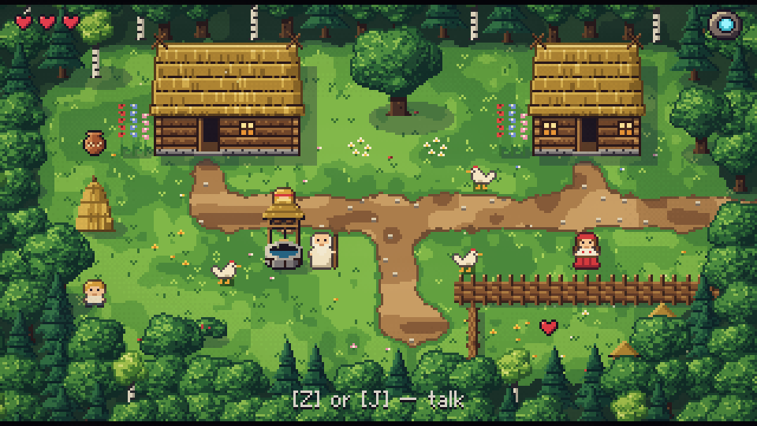
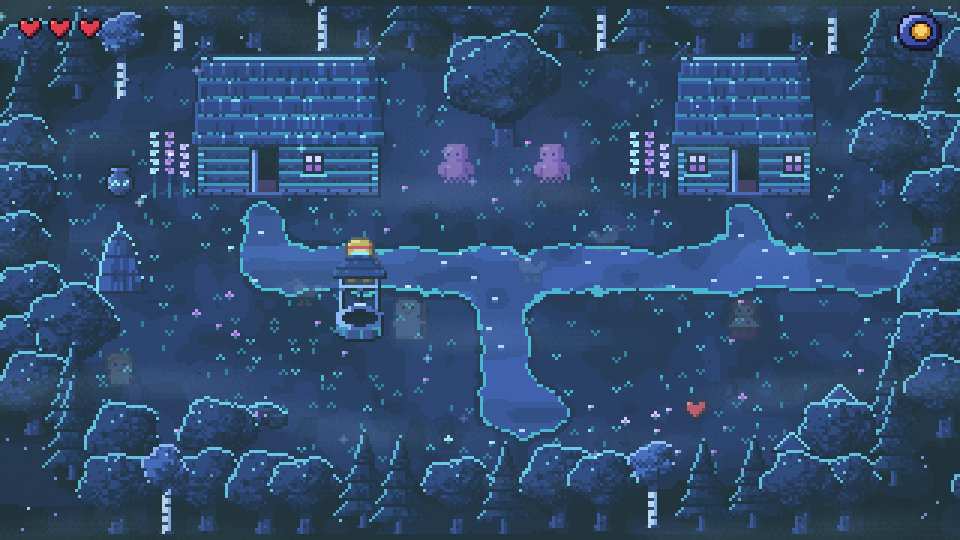
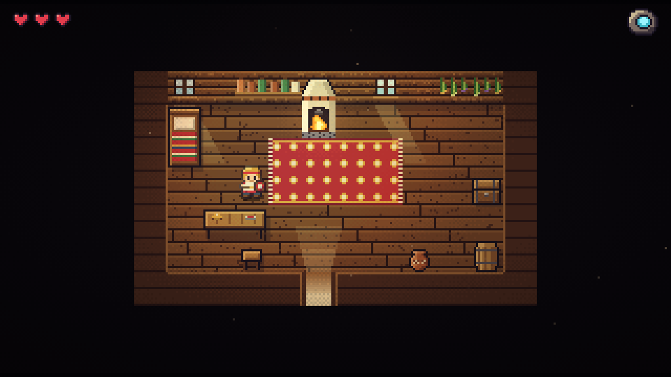
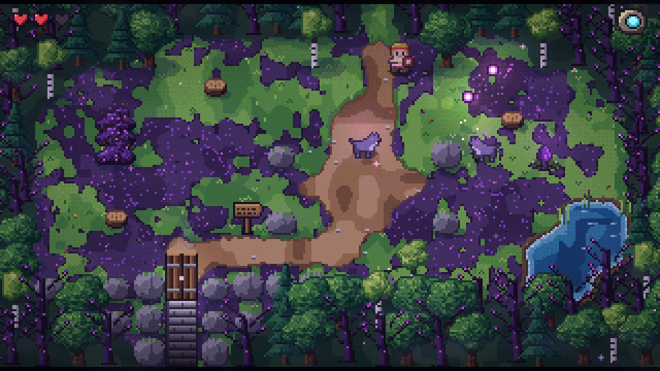

# NAWIA – projekt gry

Gra akcji z widokiem z góry na GitHub Game Off 2026 (temat: **SHIFT**, termin: 1 grudnia 2026).
Jeden przycisk przełącza między dwoma nałożonymi na siebie światami. Docelowo 15–30 minut gry.

Szczegóły techniczne są w [DEVELOPER.md](DEVELOPER.md), format pokoi w [ROOMS.md](ROOMS.md), grafika w [ART.md](ART.md),
a pisanie rozmów w [DIALOGS.md](DIALOGS.md).

| Jawia | Nawia |
|---|---|
|  |  |

| Izba, w której zaczyna się gra | Kurhan: serce skazy |
|---|---|
|  |  |

## Filary

1. **Feel przed zawartością.** Bohater reaguje od razu, cios ma ciężar (zatrzymanie klatek, wstrząs, odrzut), obrót świata jest natychmiastowy.
2. **Dwa światy, jedna mapa.** Każde miejsce istnieje w Jawi i w Nawi, ale nie tak samo. Zagadki biorą się z różnic.
3. **Pokoju trzeba się nauczyć.** Nic na ekranie nie pokazuje drugiej strony. Obrót w złym miejscu kosztuje.
4. **Jakość ponad ilość.** Mało lokacji, każda dopracowana.
5. **Od wesołej wsi do skazy.** Gra zaczyna się pogodnie: poranek, kury, malwy. Zło pojawia się dopiero w głębi lasu
   i narasta z każdym pokojem. Kontrast jest częścią opowieści.
6. **Potwory mają być straszne, nie śmieszne.** Zwieszona głowa, długie ręce, same światła zamiast oczu.
7. **Mała postać, piękny piksel.** Wzorcem wielkości i rzemiosła są 16-bitowe gry przygodowe z widokiem z góry: postać
   szeroka na jeden kafel, wysoka na jeden albo półtora, 15 kolorów, jeden ciemny kontur. Potwory mają od jednego do dwóch kafli
   wysokości. Ostateczny wybór zapada na placu prób ([PLAYGROUND.md](PLAYGROUND.md)).
8. **Słowiańszczyzna.** Świat, stwory i wierzenia biorą się z mitologii słowiańskiej i z pomysłów autora gry:
   przygoda z kluczami, bramami i dwoma światami, ale w krainie utopców, strzyg, leszego i południcy.

## Świat

- **Jawia** – tu i teraz, świat żywych. Na powierzchni jasny poranek; pod ziemią mokra ruina oświetlona ogniem.
- **Nawia** – świat duchów: to samo miejsce, jakim pamiętają je umarli. Ciemne powierzchnie, świecące krawędzie, zamiast ziemi poza światem gwiazdy.

Dzwon Budzisław w zatopionym Zwonigrodzie milczy od lat, więc umarli nie odchodzą, a granica pęka. Imiona, istoty i mity
są w [nawia-lore.md](nawia-lore.md).

**Fabuła dema.** W nocy strzyga przyszła od strony kurhanu i wyprowadziła Dobrawę, siostrę bohatera. Dobrawa szła za nią
boso, jak we śnie, a strzyga zaniosła ją pod ziemię, do Zwonigrodu. Rano Sambor, uczeń starej zielarki Radochny, budzi się
w izbie bez niczego: bez miecza, tarczy i kamienia.
- Przy pustym łóżku widać mokre ślady, a w Nawii siedzi tam cień matki.
- We wsi Staś opowiada, co widział: wysoką, zgiętą postać z włosami na twarzy i ptasimi stopami. Sulichna posyła Sambora do
  starego Racibora.
- Dziad Racibor daje mu swój miecz i tarczę ojca. Mówi mu, że strzyga ma dwie dusze, i posyła po kamień do Radochny.
- Radochna, zgryźliwa, daje kamień tylko komuś z bronią: kurzego boga, kamień z dziurą z dna Głuchego Jeziora. Mówi, jak
  uratować Dobrawę: rozkołysać Budzisława, bo kiedy granica się zamknie, co żywe, wróci na swoją stronę. Dodaje: „Kiedy
  będziecie wracać, nie oglądaj się”.
- Dalej droga wiedzie przez las do kurhanu i w dół, do grodu. Po drodze są ślady Dobrawy: przy kurhanie mówią o niej umarli,
  a w Przedsionku na kamieniu leży jej czerwona wstążka.
- W Sali Dwóch Dusz czekają strzygi, a niżej strażnik granicy. Po uderzeniu w wielki dzwon Dobrawa budzi się na brzegu
  jeziora, a dusze grodu odlatują do Wyraju jako żurawie.

**Skaza.** Tam, gdzie granica pęka, Nawia przecieka do Jawi. Widać to jako fioletowe plamy na ziemi, martwe drzewa i cierń.
Przy wsi las jest zdrowy; im bliżej kurhanu, tym skazy więcej i tym ciemniejsze powietrze.
Co skaza dotknie, dziczeje: stąd wilki o oczach w kolorze drugiej strony i kwiaty, które plują cierniami.

Teksty powierzchni są już z prawdziwego scenariusza pierwszego zadania (`src/story/village.dialog.txt`); napisy w grodzie
są jeszcze w większości robocze.

Bohater: Sambor, 18–20 lat, z mieczem i okrągłą tarczą (od Racibora). Łuk jest planowany, jeszcze go nie ma.
W grze nosi wygląd **C2f** (16×18) z placu prób. Klawisz **H** przełącza go na **S3 Malowany** (16×16), żeby porównać.
Kolizja jest u stóp i w obu wyglądach taka sama (10×8 px); wyższa postać tylko więcej zasłania.
Dawne wyglądy (Wojak, Pastuszek, Góral, Wędrowiec) zostały w kodzie i na placu prób (G1–G4).

Przeciwnicy noszą w grze nowe wyglądy z placu prób (M): wilk M1, dzik M2, topielec M5, zjawa M9, strzyga M11, ognik M13,
morownik M14. Każdy jest widziany w postaci świata, w którym jest bohater. Topielec w Jawi to mokry czarny kot, a z Nawii widać
jego prawdziwą postać. Strzyga w Jawi to ciało, a w Nawii jej druga dusza. Klawisz **B** przywraca dawne wyglądy.
Strażnik (boss) ma swój dawny wygląd.

## Sterowanie

| | Klawiatura | Gamepad |
|---|---|---|
| Ruch | WASD / strzałki | lewa gałka / krzyżak |
| Obrót kamienia | **Shift** lub Spacja | Y, lewy bumper, lewy spust |
| Cios (trzy razy: seria trzech ciosów) | Z, J lub Enter | A |
| Tarcza (trzymaj) | X lub K | B, prawy bumper, prawy spust |
| Przewrót (unik) | C, I lub lewy Alt | X |
| Rozmowa (obok mieszkańca) | Z, J lub Enter | A |
| Pauza | Esc / P | Start |
| Wyciszenie / pełny ekran / język | M / F / L | |
| Wygląd bohatera: C2f albo S3 (na czas testów) | H | |
| Wygląd przeciwników: nowe albo dawne (na czas testów) | B | |

Napisy na kamieniach i drogowskazach czytają się same, gdy bohater stanie obok. Rozmowę z mieszkańcem zaczyna klawisz ciosu.
W rozmowie: góra/dół wybiera odpowiedź, klawisz ciosu albo Shift potwierdza.

Do chat wchodzi się, po prostu wchodząc w otwarte drzwi.

## Mechaniki

**Obrót.** Natychmiastowy. Po obrocie krótka przerwa (0,22 s), zanim można obrócić ponownie.

**Granica karze.** Obrót tam, gdzie po drugiej stronie coś stoi (mur, drzewo, woda), zabiera pół serca i odstawia bohatera
do miejsca, którym wszedł do pokoju. Gra pokazuje przez chwilę, które kafle przeszkadzały.

**Co się różni między światami:**

| | W Jawi | W Nawi |
|---|---|---|
| to, co postawili lub zaniedbali żywi (gruz, płot, ciernie, kładka z desek) | jest | nie ma |
| to, co pamiętają umarli (stary mur, ścięte drzewo, stary most) | nie ma (zostają kikuty, pniaki) | jest |
| wrogowie | groźni i wrażliwi tylko w swoim świecie; z drugiej strony widać echo | |
| mieszkańcy wsi, kury | żyją swoim życiem | ledwie widoczne echo |
| dusze | nie widać ich (pod ziemią kości, na powierzchni gęściej rosną białe kwiaty) | stoją |

**Przedmioty.** Gra zaczyna się bez niczego. Miecz i tarczę daje Racibor, a kurzego boga Radochna. Bez miecza klawisz ciosu
tylko zaczyna rozmowę, bez tarczy nie ma gardy, a bez kamienia nie ma obrotu. Pierwsze miejsce, gdzie trzeba obrócić świat,
to most na skraju wsi, więc bez kamienia nie da się wyjść do lasu.

**Przewrót.** Szybki przewrót z lekkim podskokiem w stronę, w którą bohater idzie (albo patrzy): około 50 px w 0,3 s. Od
zwinięcia do rozwinięcia (około 0,2 s) nic go nie rani, ani cios, ani pocisk. Przewrotem można przerwać koniec ciosu (gdy ostrze
już minęło cel), ale nie zamach. Nie przeskakuje wody ani przepaści.

**Walka.** Wzorem są Moonlighter i Children of Morta: każdy cios ma wagę, każdy atak wroga da się przeczytać i ominąć.
- Zdrowie bohatera: 3 serca liczone połówkami. Cios wroga zabiera całe serce, pocisk pół. Ranny bohater zostaje odrzucony,
  przez chwilę traci panowanie, potem przez sekundę miga i nic go nie rani.
- **Trzy ciosy**: cięcie, cięcie z powrotem i ciężkie cięcie z góry (podwójne obrażenia, mocny odrzut). Każdy krok w serii to
  kolejne naciśnięcie. Każdy cios popycha bohatera do przodu, a bez kierunku cios sam obraca się do najbliższego wroga.
- **Tarcza** zatrzymuje cios od frontu i odsyła ogień ognika. Podniesiona w ostatniej chwili wybija wroga z rytmu na dłużej
  (dźwięczy i błyska).
- **Wrogowie ranią tylko ciosem**, nigdy samym dotykiem. Przed każdym atakiem stwór się rozgrzewa (żarzy się od środka), nad głową
  błyska mu iskra i słychać syk. Dzik i strażnik pokazują na ziemi tor, którym ruszą. Naraz atakować mogą najwyżej dwa stwory
  walczące wręcz; reszta krąży i czeka.
- Trafiony stwór odskakuje i się chwieje, co przerywa mu zamach. Tylko szarża dzika i skok strzygi idą dalej mimo ciosu.
  Po pierwszym ciosie nad stworem widać pasek jego zdrowia. Zabity rozpada się na piksele, z których był narysowany.
- **Areny i fale.** Niektóre pokoje zamykają za bohaterem wyjścia (kraty, na powierzchni wrota) do końca walki, a w niektórych po
  pierwszej grupie z ziemi wychodzą kolejne. Ranny bohater czasem znajduje serce tam, gdzie padł stwór.

**Bramy.** Otwierają się, gdy w pokoju zapadnie cisza po obu stronach (nie ma wrogów w żadnym świecie) albo gdy zadzwoni mały dzwon.

**Śmierć.** Bohater wraca tam, gdzie wszedł do pokoju, z pełnym zdrowiem. Pokój zaczyna się od nowa.

## Wrogowie

| Wróg | Świat | Zdrowie | Zachowanie | Jak go pokonać |
|---|---|---|---|---|
| Utopiec | Jawia | 4 | podchodzi, przykuca, skacze po prostej | zejść z linii albo przyjąć na tarczę, potem seria |
| Zjawa | Nawia | 3 | krąży, potem przelatuje przez bohatera; lata nad wodą i otchłanią | tarcza w jej stronę albo przewrót, cios po przelocie |
| Ognik | Jawia | 1 | wisi nad wodą i pluje ogniem | tarcza odsyła mu jego własny ogień |
| Strzyga | oba | 4 + 4 | szybka, kluczy i skacze (skoku nie przerwie żaden cios); zabita w Jawi wstaje w Nawi | przewrót przez skok, seria w plecy; pójść za nią na drugą stronę |
| Dzik | Jawia | 6 | grzebie racicą (na ziemi widać tor), potem szarżuje daleko po prostej; ciosy go nie zatrzymują | zejść z toru; gdy wpadnie na ścianę albo drzewo, długo stoi ogłuszony i bierze podwójne obrażenia |
| Wilk (skażony) | Jawia | 4 | krąży po ziemi jak zjawa w powietrzu, skacze, odskakuje | tarcza w jego stronę, seria zaraz po skoku; zwykle są dwa |
| Morownik (kwiat skazy) | Jawia | 3 | nie rusza się; otwiera się i pluje trzema cierniami w wachlarzu | podejść między salwami i ciąć; tarcza zatrzymuje ciernie |
| Strażnik (boss) | granica | 9 | w Jawi kamień, którego stal nie rani (rani tylko szarżą, poza nią odpycha); w Nawi serce w skorupie | sprowokować szarżę w ścianę lub gruz, obrócić kamień i bić w odsłonięte serce (3 ciosy na ogłuszenie, 3 fazy) |

Liczby: tabela `SPECS` w `src/entities/Enemy.ts` i `TUNE.boss` w `src/config.ts`.

## Przebieg gry

Mapa świata (każde pole to jeden ekran; strzałki pokazują kolejność):

```
Izba ⇄ Wieś ⇄ Chata zielarki          (⇄ to drzwi)
          │
          └──► Skraj wsi
             │
             ▼
      Stary gościniec ──► Uroczysko (opcjonalne)
             │
             ▼
          Kurhan
             │
             ▼
       Przedsionek ──► Zerwany most ──► Krypta            Wielki Dzwon
                                          │                    ▲
                                          ▼                    │
       Mały dzwon ◄──── Ulica (2 ekrany) ─┘                 Strażnik
             │                                                 ▲
             ▼                                                 │
          Topiel ──► Słońce i Księżyc ──► Kładki ──► Sala Dwóch Dusz
```

### Powierzchnia: nauka

| Pokój | Plik | Czego uczy |
|---|---|---|
| **Izba** | `h1-home` | Początek gry: bohater otwiera oczy we własnej izbie, bez niczego. Ruch. Puste łóżko Dobrawy mówi, co się stało; w Nawii siedzi przy nim cień matki. |
| **Wieś** | `s1-village` | Rozmowy i drzwi. Nic tu nie rani: kury, stóg, malwy, ule. Staś widział strzygę, Sulichna posyła do Racibora, Racibor daje miecz i tarczę. Pod lipą stoją umarli (widać ich po obrocie). Ogródek za płotem jest dostępny tylko z Nawi. |
| **Chata zielarki** | `h2-hut` | Radochna daje kurzego boga (tylko komuś z bronią) i mówi, jak uratować Dobrawę. Rozmowa z wyborem. |
| **Skraj wsi** | `s2-shrine` | Pierwszy obrót, który jest potrzebny: kładki nie ma, stary most stoi tylko w Nawi. Obrót z powrotem na moście to pierwsze spotkanie z karą. Bożek, przed nim ogień. |
| **Stary gościniec** | `s3-forest-road` | Pierwsza walka, jeszcze z niczym nienaturalnym: dzik przy strudze. Potem zapora z dwóch warstw: ciernie skazy blokują w Jawi, a deski na strudze są tylko w Jawi. Trzeba przejść ciernie w Nawi i wrócić do Jawi. Za cierniami zaczyna się skaza: zjawa po stronie Nawi, morownik po stronie Jawi. |
| **Uroczysko** | `s4-forest-pond` | Opcjonalne. Tarcza: brama otwiera się po zabiciu dwóch ogników, a miecz ich nie sięga. Za bramą stary most na wyspę (tylko w Nawi), na wyspie serce. |
| **Kurhan** | `s5-barrow` | Serce skazy i sprawdzian: brama do zejścia otwiera się, gdy padną dwa wilki i morownik w Jawi oraz zjawa w Nawi. Ciernie i pamiętane drzewa (w Jawi pniaki) sprawiają, że polana ma inny kształt po każdej stronie. |

### Gród: sprawdzian

| Pokój | Plik | O co chodzi |
|---|---|---|
| Przedsionek | `01-threshold` | powtórka z obrotu w kamieniu: gruz w Jawi, stary mur w Nawi |
| Zerwany most | `02-bridge` | kładka tylko w Jawi, stary most tylko w Nawi; kamienne filary to jedyne miejsca, gdzie obrót jest bezpieczny |
| Krypta | `03-crypt` | utopce w Jawi, zjawy w Nawi; krata otwiera się, gdy ucichną obie strony |
| Ulica | `04-street` | pokój szeroki na dwa ekrany: gruz i kładka w Jawi, brama grodu i stary most w Nawi; każde przejście wymaga drugiej strony |
| Mały dzwon | `05-bell` | dzwon otwiera kratę w dół |
| Topiel | `06-pool` | krata otwiera się po zabiciu ogników: trzeba użyć tarczy |
| Słońce i Księżyc | `07-sunmoon` | kamień uderzony mieczem zamienia miejscami dwa rodzaje słupów |
| Kładki | `08-crossings` | skrzyżowań kładki i mostu nie widać: czysta pamięć |
| Sala Dwóch Dusz | `09-souls` | dwie strzygi |
| Strażnik | `10-guardian` | boss, którego trzeba pokonać w obu światach |
| Wielki Dzwon | `11-greatbell` | zakończenie |

`npm run rooms:check` podaje dla każdego celu najmniejszą liczbę obrotów. Dziś: mały dzwon 9, kamień słońca i księżyca 9, wielki dzwon 14
(licząc od wioski; kraty uznawane są za otwarte, wrogowie pomijani).

## Zasady projektowania pokoi

- Pokój ma jeden pomysł. Jeśli wprowadza coś nowego, wprowadza to bezpiecznie, zanim tego zażąda.
- Różnice między światami mają mieć ślad w obrazie: ścieżka wchodzi pod ciernie („droga biegnie dalej, tylko nie tutaj”),
  po ściętym drzewie zostaje pniak, po starym murze kikuty.
- Ścieżka (`,`) istnieje w obu światach: to bezpieczny grunt i nić przewodnia.
- Brama potrzebuje ciszy po obu stronach, więc pokój z bramą wymusza walkę w obu światach.
- Walka odbywa się na otwartej przestrzeni; korony drzew zasłaniają bohatera i wrogów.

## Co dalej

Pomysły w kolejności, w jakiej wydają się warte zrobienia przed terminem:

1. Wybór na placu prób: wysokość bohatera (16×16 czy 16×24), kostium, które potwory, nastrój scenerii.
   Potem przeniesienie wybranych postaci do gry (klatki ciosu i gardy, ataki potworów).
2. Scenariusz: prawdziwe teksty rozmów w miejsce roboczych; rozmowy, które coś zmieniają w świecie.
3. Przemalować gród w tym samym stylu co powierzchnię (dziś loch jest w starszej technice).
4. Dźwięk powierzchni: gra tam jedna melodyjka wsi, z przerwami, i nic ciągłego; przy gęstej skazie i w Nawi milknie. Las nie ma własnej melodii. Jeśli ma dojść coś jeszcze, to oszczędnie (ptaki, woda), nie w pętli.
5. Łuk: strzał przez wodę i otchłań, przełączniki na odległość.
6. Leszy jako pan skażonego lasu (mini-boss przed kurhanem).
7. Balans po grze ręką: dziś trudność znana jest tylko z liczb.
