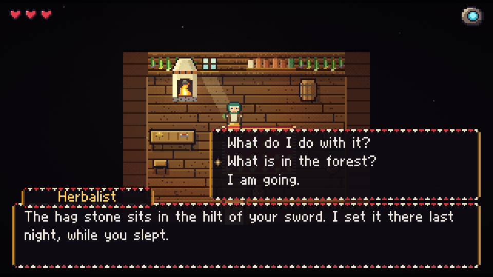

# Dialogi: jak pisać rozmowy

Ten plik jest dla osoby, która pisze scenariusz. Nie trzeba znać kodu: rozmowy to zwykłe pliki tekstowe.

- Pliki leżą w `src/story/` i mają rozszerzenie `.dialog.txt` (np. `village.dialog.txt`).
- Można mieć ich dowolnie wiele; gra wczytuje wszystkie. Nazwy węzłów są wspólne dla wszystkich plików.
- `npm run dev` odświeża grę po zapisaniu pliku. `npm run rooms:check` sprawdza, czy każda rozmowa dokądś prowadzi.



## Najkrótszy przykład

```
# gospodyni
@ Gospodyni | Housewife
Malwy w tym roku wysokie, pszczoły ciężkie. | The hollyhocks are tall this year, the bees heavy.
```

Trzy rzeczy: **węzeł** (`# gospodyni`), **kto mówi** (`@ ...`) i **kwestia**. Wszędzie obowiązuje zapis `polski | angielski`.
Jeśli nie ma części po `|`, w obu językach pokaże się to samo.

## Wszystkie znaki

| Linia zaczyna się od | Znaczenie | Przykład |
|---|---|---|
| `#` | nowy węzeł, czyli nazwany kawałek rozmowy. W nazwie litery (bez polskich znaków), cyfry, kropka, myślnik, podkreślnik | `# zielarka.las` |
| `@` | kto wypowiada kolejne kwestie. Samo `@` oznacza narratora (bez tabliczki z imieniem) | `@ Zielarka \| Herbalist` |
| (zwykły tekst) | kwestia. Gracz czyta ją i naciska klawisz | `Wstałeś wreszcie. \| Up at last.` |
| `?` | odpowiedź do wyboru, ze strzałką do węzła, do którego prowadzi | `? Idę. \| I am going. -> zielarka.zegnaj` |
| `->` | skok do innego węzła | `-> zielarka.pytania` |
| `-> ... if` | skok tylko wtedy, gdy coś zostało zapamiętane | `-> zielarka.znowu if zielarka.poznana` |
| `-> ... unless` | skok tylko wtedy, gdy czegoś nie zapamiętano | `-> starzec.wstep unless starzec.poznany` |
| `[+nazwa]` | zapamiętaj coś | `[+zielarka.poznana]` |
| `[-nazwa]` | zapomnij | `[-ma.klucz]` |
| `//` | komentarz dla autora, gra go pomija | `// TODO: druga wersja po bossie` |

`-> end` (albo odpowiedź prowadząca do `end`) kończy rozmowę. Rozmowa kończy się też sama, gdy węzeł dobiegnie końca i nie ma w nim ani odpowiedzi, ani skoku.

## Jak gra czyta węzeł

Od góry do dołu, linia po linii:

1. kwestia: pokazuje ją i czeka na klawisz,
2. `[+...]` / `[-...]`: zapamiętuje i idzie dalej,
3. `->`: jeśli warunek jest spełniony (albo go nie ma), przeskakuje do wskazanego węzła,
4. `?`: zbiera wszystkie odpowiedzi stojące jedna pod drugą i pokazuje je graczowi. Ostatnia kwestia zostaje na ekranie jako pytanie.

Dlatego warunkowy skok na samej górze węzła działa jak „jeśli już rozmawialiśmy, zacznij gdzie indziej”.

## Pełny przykład: rozmowa z wyborem i powrotem do pytań

```
# zielarka
-> zielarka.znowu if zielarka.poznana
@ Zielarka | Herbalist
Wstałeś wreszcie. Słońce już wysoko. | Up at last. The sun is high already.
[+zielarka.poznana]
-> zielarka.pytania

# zielarka.znowu
@ Zielarka | Herbalist
Jeszcze tu jesteś? Dzwon sam się nie rozkołysze. | Still here? The bell will not swing by itself.
-> zielarka.pytania

# zielarka.pytania
? Co mam z nim zrobić? | What do I do with it? -> zielarka.kamien
? Co jest w lesie? | What is in the forest? -> zielarka.las
? Idę. | I am going. -> zielarka.zegnaj

# zielarka.kamien
@ Zielarka | Herbalist
Przekręć go, a zobaczysz Nawię. | Turn it and you will see Nawia.
-> zielarka.pytania

# zielarka.zegnaj
@ Zielarka | Herbalist
Idź. I wróć, zanim zakwitnie paproć. | Go. And be back before the fern blooms.
```

Węzeł `zielarka.pytania` nie ma własnych kwestii, same odpowiedzi. Po każdej odpowiedzi rozmowa do niego wraca, więc gracz może zapytać o wszystko po kolei.

## Podpięcie rozmowy do postaci albo napisu

W pliku pokoju (`src/world/rooms/*.room.txt`) cyfra na mapie ma swój blok `sign`. Linia zaczynająca się od `@` wskazuje węzeł:

```
sign 1:
  look: herbalist
  jawia: @zielarka
```

- `look:` robi z cyfry mieszkańca (`herbalist`, `elder`, `woman`, `child`). Bez `look:` to drogowskaz albo kamień z napisem.
- `jawia:` i `nawia:` mogą wskazywać różne węzły: ta sama postać albo ten sam napis mówi co innego po każdej stronie.
  Mieszkaniec bez linii `nawia:` jest w Nawi tylko echem i milczy.
- Zamiast `@węzeł` można wpisać sam tekst (`jawia: Dzień dobry. | Good morning.`). Mieszkaniec powie wtedy tę jedną kwestię;
  drogowskaz pokaże ją sam, gdy bohater stanie obok.
- **W izbie** napis bez `look:` nie jest drogowskazem, tylko niewidocznym miejscem w izbie, które samo „mówi”, gdy bohater
  stanie obok, np. puste łóżko Dobrawy w `h1-home` (`jawia:` mówi, co widać, a `nawia:` co mówi cień matki). Nie zawadza
  w chodzeniu.

Rozmowę zaczyna klawisz ciosu (Z / J / Enter, na padzie A), gdy bohater stoi obok. W rozmowie: góra/dół wybiera odpowiedź,
klawisz ciosu albo Shift potwierdza. Naciśnięcie w trakcie pisania kwestii pokazuje ją od razu w całości.

## Zapamiętywanie

To, co zapisze `[+nazwa]`, jest pamiętane do końca rozgrywki i widzą to wszystkie rozmowy. Nazwy są dowolne; dobrze poprzedzać
je imieniem postaci (`starzec.poznany`), żeby się nie myliły. Po odświeżeniu strony gra zaczyna od zera: zapisu stanu jeszcze nie ma.

## Przedmioty

Trzy znaczniki mają w grze skutek: dają bohaterowi to, czego bez nich nie ma.

| Znacznik | Co daje | Bez niego |
|---|---|---|
| `[+ma.miecz]` | miecz | klawisz ciosu tylko zaczyna rozmowę |
| `[+ma.tarcza]` | tarczę (bohater od razu jest rysowany z tarczą) | nie ma gardy |
| `[+ma.kurzy-bog]` | kurzego boga: obrót świata | Shift pokazuje tylko „Nie masz czego przekręcić” |

Bohater dostaje przedmiot w chwili, gdy rozmowa się kończy. Dobrze jest powiedzieć to graczowi kwestią narratora
(sam znak `@`, bez imienia), np. `Racibor daje ci miecz i okrągłą tarczę.` Przykład: węzeł `dziad.bron` w
`src/story/village.dialog.txt`.

Na tych samych znacznikach można opierać rozmowy: `-> zielarka.bezbroni unless ma.miecz` (Radochna nie da kamienia
komuś bez broni), `-> dziecko.potem if ma.miecz` (Staś poznaje miecz dziadka).

Gra startuje bez żadnego z nich. Skrót dla testów `?room=...` (wejście od razu do pokoju) daje wszystkie trzy.

Innych skutków w świecie (otwarcia bramy, zmiany pokoju) pamięć rozmów na razie nie ma. Jeśli scenariusz tego potrzebuje,
to jest zmiana w kodzie: patrz [DEVELOPER.md](DEVELOPER.md), sekcja o rozmowach.

## Ograniczenia, o których warto wiedzieć przy pisaniu

- **Długość kwestii.** Okno mieści 3 wiersze, razem około 120 znaków. Dłuższą myśl podziel na dwie kwestie (dwie linie w pliku).
  `npm run rooms:check` ostrzega o kwestiach dłuższych niż 125 znaków.
- **Odpowiedzi.** Najwyżej 4 naraz, każda w jednym wierszu: do około 28 znaków.
- **Imię mówiącego** mieści się na tabliczce do około 13 znaków.
- W tekście nie można użyć znaku `|` (oddziela języki) ani zaczynać kwestii od `#`, `@`, `?`, `->`, `[+`, `[-`, `//`.
- Czcionka ma polskie znaki. Nie ma w niej emoji ani znaków spoza alfabetu łacińskiego.

## Sprawdzenie

```bash
npm run rooms:check
```

Skrypt wypisze, jeśli:

- odpowiedź albo skok prowadzi do węzła, którego nie ma,
- pokój wskazuje rozmowę `@...`, której nie ma,
- kwestia jest za długa (ostrzeżenie).

Literówka w nazwie węzła to najczęstszy błąd. W trybie `npm run dev` te same ostrzeżenia pojawiają się w konsoli przeglądarki.
