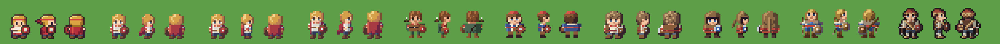
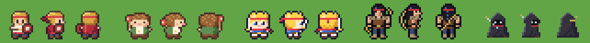
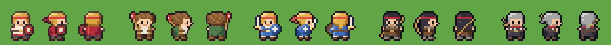
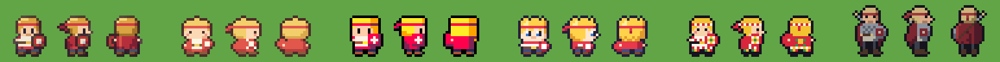
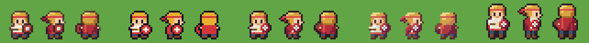

# Plac prób: wybór stylu i klimatu

Plac prób to osobna scena, w której nic się nie dzieje poza tym, że bohater chodzi. Służy do jednego: żeby postawić obok siebie
warianty bohatera, mieszkańców, potworów i scenerii, obejrzeć je w ruchu i wskazać, co zostaje. Nic stąd nie jest jeszcze
użyte w grze. To, co zostanie wybrane, przenosi się do gry. **Dopóki trwa wybieranie, nic stąd nie znika**: to, co odpadło,
trafia do archiwum.

## Plansza i archiwum: szybka selekcja

Kto stoi na planszy, w jakiej kolejności i pod jakimi nagłówkami, jest zapisane w jednym pliku tekstowym:
**`src/lab/lineup.txt`**. Ma dwie części:

```
board:
* Nowe koncepty | New concepts      <- nagłówek nad nowym rzędem planszy
C1   najlepsze z wybranych, 16x16   <- kod, a za nim dowolna notatka dla Ciebie
C2   to samo, 16x20

archive:
W4   Łowca potworów: odpada
```

- **Zdjąć coś z planszy**: przenieść jego linijkę pod `archive:` i odświeżyć stronę. Nic nie jest kasowane.
- **Przywrócić**: przenieść linijkę z powrotem nad `archive:`.
- **Zmienić kolejność**: przestawić linijki. Rząd mieści siedem postaci; dłuższa grupa przechodzi do następnego rzędu.
- Notatki za kodem plac pomija, więc można tam pisać werdykty („za duża głowa”, „odpada”).
- Kod, którego plac nie zna, i bohater, którego nie ma w żadnej części, są wypisywane w konsoli przeglądarki.
- Mieszkańców (N) i potworów (P) ten plik na razie nie dotyczy: stoją na swoich miejscach.
- Bohatera z archiwum można obejrzeć w ruchu bez przenoszenia linijki: `?lab&hero=W4`.

## Teraz wybieramy: styl graficzny bohatera

Bohater to (na 90%) **Sambor**: młody mężczyzna, 18–20 lat, już z męskimi rysami, który rusza szukać siostry; w drodze ma
mężnieć. Trochę Thorgal, trochę wiedźmin, trochę hobbit i elfi łucznik, ale nigdy kopia któregoś z nich. Nosi miecz i okrągłą
tarczę. Twoje decyzje i uwagi są w [DESIGN-DECISIONS.md](DESIGN-DECISIONS.md), świat i imiona w `nawia-lore.md`.

### Koncepty na planszy



| Kod | Koncept | Rozmiar | Na czym polega |
|---|---|---|---|
| **C1g** | Najlepszy | 16×16 | C1 (malowany jak S3, tony S2, oczy z powieką, białkiem i tęczówką) z bokiem z C1e: okrągła czaszka z grzywką do przodu, krótka szyja cofnięta za brodę, płaszcz zakrywa tylną połowę tułowia, tarcza jako mały krążek przy biodrze, dłuższy krok. **Oko z boku jest tym samym okiem co z przodu**: w tych samych rzędach, powieka nad białkiem i niebieską tęczówką, tęczówka z przodu. Cały rysunek jest w jednym pliku (patrz [HERO-DRAWING.md](HERO-DRAWING.md)) |
| **C1h** | Najlepszy | 16×16 | druga, niezależna wersja boku (z C1f: bardzo smukły, tarcza schowana za nim, szeroki krok), z tym samym okiem |
| **C2f** | Najlepszy 16×18 | 16×18 | C1g w wysokości między C1 a C2 |
| **C7c** | Wędrowiec, bez obrysu | 16×18 | C7 bez obrysu i z wąskim profilem; płaszcz ciemniejszy i chłodniejszy, żeby bez obrysu nie zlewał się z trawą |
| **C11b** | Kołpak | 16×18 | C11 z wąskim profilem: czapka i głowa z boku 8 px zamiast 11 |
| **C12** | Czupryna | 16×18 | **na wzorcu Moonlightera**: głowę robi postrzępiona, oświetlona pasmami czupryna, twarz osadzona nisko, ciało tak szerokie jak głowa, krótkie nogi; malowany jak C1, wąski profil; lniana koszula z haftem, kożuszany serdak, ciemnoczerwony pas, drewniana tarcza w okuciu |
| **C13** | Kaptur | 16×18 | **na wzorcu bohatera 16-bitowego**: głowę robi nakrycie, a z boku i z tyłu ogon kaptura opada na plecy, więc profil jest kroplą, nie jajkiem; duża tarcza, nasycone barwy, bez obrysu; brązowy wełniany kaptur z peleryną, bordowa tunika, niebieska tarcza z białą tarczą słoneczną |

Wszystkie mają trzy widoki, stanie i dwa kroki, i mieszczą się w 15 kolorach. C8b i C6b (bez werdyktu) stoją na początku drugiej grupy.

**Zasady profilu** (z Twoich wzorców i uwag):
- głowa z boku nie jest głębsza niż tułów z płaszczem pod nią (7–8 px); szersza wygląda jak jajko albo ET;
- obrys głowy z boku łamią włosy albo nakrycie (płaski tył, kosmyki, ogon kaptura), nie gładki owal;
- twarz to przednia dolna ćwiartka głowy, z płaskim przodem: bez nosa;
- oko w profilu to **to samo oko co z przodu**: te same rzędy (powieka, pod nią białko i tęczówka), te same kolory; tęczówka z
  przodu, białko za nią, przed tęczówką jeden piksel skóry. Jeden ciemny piksel w rzędzie powieki (C1e, C1f) siedział za wysoko
  i nie przypominał oka z przodu.

Werdykty z poprzednich rund (w archiwum): C1c, C2c i C11 z boku jak jajka (poprawione w C1d, C2d, C11b), C7b do zwężenia
i bez obrysu (C7c), C10 do wyrzucenia; C1d i C2d z boku nadal słabe (poprawione w C1e, C1f, C2e); w C1e, C1f i C2e oko z boku za wysoko i niepodobne do
oka z przodu (poprawione w C1g, C1h, C2f).

**Chcesz poprawić bohatera sam, piksel po pikselu?** Wszystko o tym, jak zapisany jest rysunek, jak go zmienić i jak
obejrzeć zmianę, jest w [HERO-DRAWING.md](HERO-DRAWING.md).

Twoje obrazki wzorcowe leżą w `src/lab/reference/` (folder ignorowany przez git). Plac ich nie pokazuje: służą mi do nauki miar
i rzemiosła; postaci z nich nie kopiuję.

### Poprawki z DESIGN-DECISIONS

- **S3 Malowany**: brzeg głowy od strony, w którą idzie, jest o kilka tonów jaśniejszy (brąz skóry zamiast ciemnego brązu).
- **A1, A3, A5**: nowe wersje **A1b, A3b, A5b** z mniejszą i mniej okrągłą głową (7 wierszy i 9 pikseli zamiast 8 i 11);
  tułów zyskał wiersz, który oddała głowa. Stare A1, A3, A5 są w archiwum, do porównania.
- Lalki (A, mieszkańcy) zaczynają teraz **bez konturu**, bo tak A1 podobał się najbardziej; klawisz O nadal przełącza.

## Wcześniejsze rundy

### Cztery postacie, cztery szkoły rysunku (R1–R4)

Te same cztery archetypy co w W1–W4, ale tym razem nic nie jest wspólne: każda postać ma własną budowę, własną twarz,
własną kreskę i paletę, jakby pochodziła z innej gry.



| Kod | Postać | Szkoła | Co ją wyróżnia |
|---|---|---|---|
| **R1** | Domator | ilustracja dla dzieci | pulchny człowieczek, loki, oczy-kropki, duży nos, rumieńce, tobołek; brązowa kreska, ciepłe barwy |
| **R2** | Śmiałek | przenośne RPG | nastroszone włosy, duże niebieskie oczy z błyskiem, miecz w górze, szal na wietrze; żywe barwy, granatowa kreska |
| **R3** | Północny (16×20) | komiks | mała głowa na szerokich barach, czarne plamy cienia, granatowy połysk na czarnych włosach, gołe ramiona, łuk |
| **R4** | Łowca | sylwetka | kaptur i płaszcz do ziemi, bez twarzy: dwa błyski oczu, kamień z dziurką, czerwony szal; bez konturu |

Uwaga do R4: ciemna postać bez konturu jest czytelna na łące, ale w lochu zleje się z tłem; wtedy potrzebuje jasnego brzegu.

Żadna z postaci na placu (R, W, V, S, lalki A i B) nie ma jeszcze klatek ciosu ani gardy: tylko stanie i chód w trzech
kierunkach. Komplet (zamach, cios, garda) ma dziś wyłącznie bohater z gry (G1 i jego wyglądy G2–G4).

### Cztery wcielenia z jednego szablonu (W1–W4)

Rozmiar jest już prawie przesądzony: **jeden kafel (16×16)**, najwyżej 1,25. Tu zmienia się to, kim bohater jest. Każde wcielenie
bierze archetyp z opowieści przygodowych i robi z niego naszą własną postać. Żadne nie jest kopią cudzego bohatera: nie ma tu
ani jego imienia, ani stroju, ani znaków rozpoznawczych; jest typ postaci.



| Kod | Wcielenie | Archetyp | Jak wygląda u nas |
|---|---|---|---|
| **W1** | Domator | mały domator, który ruszył w drogę (bajki o wyprawie) | czupryna loków, serdak, zielona opończa, tobołek na kiju |
| **W2** | Śmiałek | chłopak z mieczem i tarczą z 16-bitowych przygodówek | jedna śmiała barwa tuniki (błękit), krajka, miecz w dłoni, tarcza z krzyżem słonecznym |
| **W3** | Północny | łucznik-wojownik z północy (komiks przygodowy) | długie czarne włosy, futro na barkach, gołe ramiona, łuk na plecach |
| **W4** | Łowca potworów | samotny łowca z ponurych opowieści | popielate włosy związane z tyłu, nabijana skóra, miecz na plecach, kamień z dziurką na piersi |

Wszystkie są w tym samym czystym wykończeniu co bohater z gry (głowa szeroka na 8 pikseli, oczy na dwa piksele, kontur barwny)
i mieszczą się w 15 kolorach. Są w `HERO_TYPES` w `src/art/heroStyles.ts`.

### Pięciu różnych grafików (V1–V5)

Ten sam bohater narysowany od zera pięć razy, tak jak zrobiłoby to pięć różnych osób: inne proporcje, kształt głowy, oczy,
kreska i paleta.



| Kod | Styl | Rozmiar | Czyja to ręka |
|---|---|---|---|
| **V1** | Bajka | 16×16 | ilustrator książeczek: okrągła głowa, oczy-kropki, rumieńce, płaszcz jak dzwonek; pastele, brązowa kreska |
| **V2** | Klocek | 16×16 | minimalista: kanciasta głowa, oczy-kreski, twardy cień z prawej, czarny kontur; 16 barw PICO-8 |
| **V3** | Kieszonkowy | 16×16 | ręka z przenośnych RPG: nastroszona grzywka, duże niebieskie oczy z błyskiem, czerwony szal, drobne ciało |
| **V4** | Ludowy | 16×16 | wycinanka: płaskie odświętne barwy, haft na koszuli i krajce, pasiaste portki, rozeta na tarczy |
| **V5** | Surowy | 16×20 | ponury realista: mała głowa, kolczuga, płaszcz do kolan, miecz na plecach; zgaszone barwy |

### Cztery wykończenia tego samego rysunku (S1–S4)

Wcześniejsza próba: rysunek bohatera z gry wykończony na cztery sposoby. To jedna ręka, różni się kreską i cieniowaniem.



| Kod | Wykończenie | Rozmiar | Na czym polega |
|---|---|---|---|
| **S1** | Kreska | 16×16 | płaskie plamy w czarnym konturze, 7 kolorów |
| **S2** | 16 bitów | 16×16 | trzy tony na materiał, połysk na włosach, kontur w ciemnym odcieniu tego, co obrysowuje |
| **S3** | Malowany | 16×16 | bez konturu od strony światła, ciemny brzeg tylko w cieniu; miękkie barwy |
| **S4** | Wysoki 16x20 | 16×20 | wykończenie 16 bitów na 1,25 kafla |

Wszystko to jest w `src/art/heroStyles.ts` (`HERO_SCHOOLS`, `HERO_TYPES`, `HERO_HANDS`, `HERO_STYLES`).

| Pięć pomysłów na bohatera, w dwóch wysokościach | Potwory według wielkości | Dwa kafle: bies i leszy |
|---|---|---|
|  |  |  |


## Wzorzec

Wzorcem wielkości i rzemiosła są 16-bitowe gry przygodowe z widokiem z góry. Bierzemy z nich miary i zasady, a nie rysunki:
postaci, potwory i świat są nasze, słowiańskie.

| Zasada | Co to znaczy u nas |
|---|---|
| wszystko żyje na siatce 16 px | kafel 16×16; postać ma 16 px szerokości |
| postać jest mała, a połowa z niej to głowa | bohater ma jeden kafel (16×16) albo półtora (16×24); głowa to 8 albo 10 wierszy |
| głowa nie jest szersza od tułowia | tułów z rękami ma szerokość głowy (11 px). Szeroka głowa na wąskim tułowiu wygląda jak żarówka |
| nic nie wystaje poza kafel | hełm, kaptur i uszy wilczej skóry są rysowane w obrębie komórki, osobno dla każdej wysokości |
| widok lekko z góry | górna część głowy to czubek (włosy, hełm), twarz siedzi nisko |
| 15 kolorów na postać | tyle mieściła jedna paleta sprite'a na konsoli 16-bitowej (16. to przezroczystość); materiały dzielą się kolorami: skóra butów, pasa i obręczy tarczy to jeden brąz, cień spodni to kolor konturu |
| kontur barwny | ludzie: kontur bierze ciemny odcień tego, co obrysowuje (ciepły przy skórze, włosach i rzemieniu, chłodny przy płótnie i stali). Potwory: jeden ciemny kontur. Klawisz **O** pozwala porównać trzy sposoby |
| trzy tony na materiał | cień, kolor, światło; światło zawsze z lewej góry |
| potwory w trzech wysokościach | jeden kafel, półtora, dwa. Nic nie jest wyższe niż dwa kafle |

Przy każdym eksponacie plac pokazuje, ile kolorów faktycznie zużywa. Dziś wszystkie postaci mieszczą się w 15.

## Jak wejść

- z ekranu tytułowego: strzałka w dół na **Plac prób**, potem Shift albo Z,
- albo wprost: `http://localhost:5173/?lab`,
- albo od razu na wybranym zestawie: `?lab&hero=C2&mood=zmierzch`
  (`hero`: kod bohatera, także z archiwum, np. `C2`, `S3`, `A1b`, `W4`; `size`: `small`, `tall` (wzrost mieszkańców);
  `mood`: `poranek`, `zmierzch`, `jesien`, `ponuro`, `noc`; `ink`: `tinted`, `dark`, `none`).

## Klawisze

| Klawisz | Co zmienia |
|---|---|
| WASD / strzałki | bohater chodzi |
| **Q / E** | poprzedni / następny bohater, którym się chodzi: wszyscy z planszy, w kolejności z `lineup.txt` |
| **1 / 2** | wzrost mieszkańców: 16×16 albo 16×24 |
| **O** | kontur lalek (A, mieszkańcy): bez konturu (na start) / barwny / ciemny |
| **N** | nastrój scenerii (pora dnia, pora roku) |
| **Shift** | świat: Jawia / Nawia |
| **G** | siatka kafli 16 px |
| **T** | podpisy eksponatów |
| L / M / F | język / wyciszenie / pełny ekran |
| **Esc** | powrót do menu |

Wybrane ustawienia widać na górze ekranu. Gdy bohater stanie przy eksponacie, na dole pojawia się jego kod, nazwa,
rozmiar w pikselach, liczba kolorów i jedno zdanie o pomyśle, który za nim stoi.

## Co tam stoi

Każdy eksponat ma kod. Wystarczy napisać „bohater C2, strzyga P9, zjawa P12, sceneria: ponuro”.
Które kody stoją na planszy, decyduje `src/lab/lineup.txt`; poniżej są wszystkie, jakie istnieją.

| Kody | Co | Zachowanie |
|---|---|---|
| **C1–C11** i wersje z literą (**C1b, C1c, C2b, C2c, C6b, C7b, C8b**) | koncepty bohatera; litera to kolejna poprawka, poprzednie wersje są w archiwum | obracają się; w każdą stronę najpierw stoją, potem idą w miejscu |
| **G1–G4** | bohater z gry i jego wyglądy spod klawisza H: Pastuszek, Góral, Wędrowiec | jak wyżej |
| **R1–R4** | cztery postacie w czterech szkołach rysunku | jak wyżej |
| **W1–W4** | cztery wcielenia z jednego szablonu | jak wyżej |
| **V1–V5** | jeden bohater, pięciu różnych grafików | jak wyżej |
| **S1–S4** | rysunek z gry w czterech wykończeniach | jak wyżej |
| **A1–A5**, **A1b, A3b, A5b** | lalki na jeden kafel: pięć pomysłów na postać; „b” to wersja z mniejszą głową | jak wyżej |
| **B1–B5** | te same lalki na półtora kafla (16×24) | jak wyżej |
| **X1–X6** | postacie ze „szkieletu” (głowa szersza od tułowia), 16×16 i 16×24 | jak wyżej |
| **Z1–Z4** | pierwsze ręcznie rysowane zwierzęta (żmija, wilki, dzik) | chodzą tam i z powrotem |
| **N1–N4** | mieszkańcy: zielarka, starzec, gospodyni, dziecko (w wysokości wybranej klawiszem 1 / 2; dziecko ma zawsze jeden kafel) | stoją w zagrodach i obracają się |
| **P1–P16** | potwory, pogrupowane według wysokości | chodzą tam i z powrotem; ognik i morownik stoją |

Pomysły na postać z poprzedniej iteracji (lalki; ten sam numer w obu wysokościach):

| Nr | Kto | Pomysł |
|---|---|---|
| 1 | **Wojak** | chłopak ze wsi: jasne włosy do szczęki, krajka na czole, lniana koszula z czerwonym haftem przy kołnierzu, mankietach i u dołu, tarcza po ojcu |
| 2 | **Drużynnik** | człowiek księcia: szyszak z nosalem i kolczym czepcem, kolczuga, niebieski płaszcz, wąsy, tarcza z okuciem |
| 3 | **Łowca** | kaptur z pelerynką, skórzany kaftan, łuk i kołczan na plecach, miecz u pasa |
| 4 | **Wilczy kaptur** | skóra wilka na głowie i plecach: uszy na rogach, kły nad brwiami, czerwona tunika |
| 5 | **Kołpak** | czapka z futrzanym otokiem, zielona sukmana ze złotym szyciem i czerwonym pasem, tarcza zarzucona na plecy |

Dwie wysokości to osobne rysunki, nie jeden pomniejszony:

- **16×16** zajmuje dokładnie kafel, na którym stoi. To najczytelniejsze w grze (kolizje, zasięg miecza, chowanie się za drzewami
  są oczywiste) i najbliższe grom 8-bitowym. Osiem wierszy głowy, siedem ciała: koszula, pas, nogi.
- **16×24** ma głowę na wysokości kafla za sobą. Dziesięć wierszy głowy, trzynaście ciała: jest miejsce na haft, pas, płaszcz i krok.
  Tak budowano bohaterów w 16-bitowych grach przygodowych: kolizja u stóp ma nadal jeden kafel, a wyżej jest tylko obraz.

Potwory:

| Kod | Kto | Wysokość | Pomysł |
|---|---|---|---|
| P1 | Ognik | 1 kafel | błędny ogień nad bagnem; z gry, bez zmian |
| P2 | Morownik | 1 kafel | kwiat skazy; z gry, bez zmian |
| P3 | Żmija | 1 kafel (półtora długości) | pełznie esem po ziemi, łeb uniesiony; zygzak na grzbiecie |
| P4 | Wilk A: wilk szary | 1 kafel (półtora długości) | skrada się: łeb niżej łopatek, ciemny grzbiet, jasny spód, ogon w dół |
| P5 | Wilk B: wilk skazy | 1 kafel (półtora długości) | ten sam wilk, przez którego przerosła skaza: fiolet, kolce na grzbiecie, oko w kolorze Nawi |
| P6 | Dzik | 1 kafel (półtora długości) | sam kark: garb ze szczeciną, długi łeb nisko, szable, czerwone oko |
| P7 | Utopiec A: topielec | 1,5 kafla | opuchnięty trup w wodorostach, ręce do ziemi |
| P8 | Utopiec B: wodnik | 1,5 kafla | chudy, śliski, płetwy zamiast uszu |
| P9 | Strzyga A: jędza | 1,5 kafla | wychudła, zgarbiona, szpony do ziemi, włosy na twarzy |
| P10 | Strzyga B: sowa | 1,5 kafla | płaszcz z piór, dwa oczodoły ze światłem na dnie, dziób |
| P11 | Zjawa A: całun | 1,5 kafla | pusty kaptur, w środku dwa światła; rozwiewa się u dołu |
| P12 | Zjawa B: południca | 1,5 kafla | kobieta w bieli, czarne włosy na twarzy, sierp, wianek z kłosów |
| P13 | Upiór | 1,5 kafla | drużynnik, który nie odszedł: kości i rdza |
| P14 | Licho | 1,5 kafla | jedno oko, sama skóra i kości |
| P15 | Bies | 2 kafle | rogi, ogon, kopyta: stary diabeł z bagien |
| P16 | Leszy | 2 kafle | pan lasu: kora, mech, poroże, czaszka zamiast twarzy |

Zwierzęta (żmija, wilki, dzik) są rysowane ręcznie, klatka po klatce, z profilu.

## Nastroje scenerii (klawisz N)

Ta sama łąka, wieś, staw i krąg kamieni w pięciu wersjach: **poranek** (obecny wygląd gry), **zmierzch** (ciepłe światło, fioletowe
cienie), **jesień** (rdzawe liście, pożółkła trawa), **ponuro** (bez słońca, kolory wyprane) i **noc**. Postaci są podbarwiane
światłem danej pory. Prawy koniec łąki jest zarośnięty skazą, żeby było ją widać w każdym nastroju.
Nawia ma jeden wygląd: tam nie ma pogody.

## Jak są zrobione postaci

- **Koncepty bohatera (C)** są rysowane w całości: dziewięć obrazków (trzy widoki, stanie i dwa kroki), każdy tak wysoki jak
  postać. Nie dzielą z sobą niczego poza formatem (`src/art/concepts/concept.ts`), więc każdy może mieć inną budowę i kreskę.
- **Lalki** (wcześniejsze pomysły na bohatera i mieszkańcy) są rysowane ręcznie, jako tekst, w `src/art/dolls.ts`. Postać to „lalka z papieru”:
  ciało (osobny rysunek na każdy widok i każdy krok), na nim głowa, a pod i nad nimi to, co niesie (tarcza, płaszcz, łuk, miecz,
  fartuch, kij). Ciała są wspólne; pomysł na postać to głowa w trzech widokach, paleta i lista rzeczy. Kontur dorysowuje się sam.
- **Potwory dwunożne** składa „szkielet” (`src/art/rig.ts`): z proporcji, materiałów i dodatków robi trzy widoki
  i pięć klatek chodu.
- **Zwierzęta** są rysowane ręcznie z profilu (`src/art/cast.ts`): ciało raz, do tego trzy układy nóg. Żmija jest zadana
  kolumna po kolumnie, więc druga klatka to ten sam wąż chwilę później.

Czego jeszcze nie ma: zamachu mieczem, gardy, obrażeń, ataków potworów. Postaci na placu tylko stoją i chodzą.

## Dla developera

| Co | Gdzie |
|---|---|
| scena | `src/scenes/PlaygroundScene.ts`: `catalogue()` zna wszystkich bohaterów po kodach; rzędy planszy to `HERO_ROWS`, miejsca w rzędzie `HERO_COLS` |
| plansza i archiwum | `src/lab/lineup.txt` (czyta go `src/lab/lineup.ts`) |
| mapa łąki | `src/lab/playground.room.txt` (zwykły plik pokoju; nie należy do świata gry) |
| koncepty bohatera | `src/art/concepts/*.concept.ts` (każdy w swoim pliku, eksportuje `CONCEPT`); format i zasady w `concept.ts`; plac znajduje je sam (`index.ts`) |
| style bohatera | `src/art/heroStyles.ts`: `HERO_SCHOOLS` (R), `HERO_TYPES` (W), `HERO_HANDS` (V) i `HERO_STYLES` (S): głowa z tułowiem, trzy układy nóg, tarcza, paleta, sposób obrysowania; `styleFrame`, `styleSheet` |
| ludzie (lalki) | `src/art/dolls.ts`: ciała `TALL_SHIRT`, `SMALL_SHIRT`, `*_ROBE`; głowy `HEAD_*`; rzeczy (`SHIELD`, `CLOAK_*`, `BOW_*`...); `HERO_LOOKS`, `FOLK_LOOKS`; `dollFrame`, `dollSheet` |
| archiwum | `src/art/archive.ts`: wcześniejsze postacie ze szkieletu i pierwsze zwierzęta, bez zmian |
| szkielet potworów | `src/art/rig.ts`: `Figure`, `figureFrame`, `figureSheet` |
| potwory | `src/art/cast.ts`: `CREATURES`, rysunki zwierząt |
| nastroje | `MOODS` w `src/art/surface.ts` |

Litery w rysunkach ludzi znaczą wszędzie to samo (`h H l` włosy, `s S t` skóra, `a A b` koszula, `r R` haft, `p P` spodnie,
`f F` buty, `c C d` płaszcz albo kaptur, `m n M` metal...; pełna lista jest na górze `dolls.ts`), więc pod ten sam rysunek
można podłożyć inną paletę.

- **Nowy styl albo wcielenie bohatera**: wpis w `HERO_TYPES`, `HERO_HANDS` albo `HERO_STYLES` (`shield` może być listą rzeczy: miecz i tarcza, łuk, tobołek): `upper` (głowa i tułów, od góry komórki), `legs` (stoi, krok, drugi krok),
  `shield` (rysunek i miejsce w każdym widoku), `pal`, `ink` (`drawn`: kontur jest w rysunku jako litera `o`; `tinted`: dorysowany
  dookoła; `rim`: dorysowany tylko z prawej i u dołu) i `line` (kolor dorysowanej kreski przy danej literze). Wysokość komórki to `fh`.
- **Nowy koncept bohatera**: nowy plik `src/art/concepts/<id>.concept.ts` z obiektem `Concept`: `code` (np. `C7`), `h` (16–23),
  `pal` (kolor każdej litery), `frames` (dla `down`, `up`, `side` po trzy rysunki: stoi, krok, drugi krok; każdy wiersz
  ma dokładnie 16 znaków, ostatni wiersz pusty, stopy w przedostatnim) i `ink` (`none`, `dark`, `tinted`, `rim`, jak wyżej).
  Potem jedna linijka z kodem w `lineup.txt`. `checkConcept()` wypisuje, co jest nie tak (wymiary, nieznane litery, ponad 15 kolorów).
- **Bohaterowie znani placowi** to `catalogue()` w scenie; kto stoi na planszy i jest pod Q / E, mówi `lineup.txt`.
- **Nowy pomysł na postać (lalka)**: wpis w `HERO_LOOKS`: `head` (głowa: po trzy rysunki dla `tall` i `small`; 10 i 8 wierszy,
  ostatni to podbródek), `pal` (kolor każdej litery), `line` (które litery biorą ciepły kontur; reszta dostaje `pal.o`),
  `gear` (rzeczy i to, czy w danym widoku leżą pod ciałem, na nim, czy na wierzchu). `stillArm` wyłącza machanie ręką
  z tarczą w widoku z boku, `weave` zmienia literę zależnie od miejsca (oczka kolczugi).
- **Nowa rzecz** (np. włócznia): po trzy rysunki 16 px szerokości dla obu wysokości i wpis `Gear`.
- **Nowy mieszkaniec**: wpis w `FOLK_LOOKS`; `body: 'robe'` daje długą szatę albo spódnicę (litery spodni to wtedy spódnica),
  `only: 'small'` trzyma postać przy wzroście jednego kafla.
- `node` rysuje to bez przeglądarki: `dollFrame(look, size, view, pose)` zwraca `PixelBuffer`.
- **Nowy potwór dwunożny**: wpis w `CREATURES` z `tiles` (1, 1.5 albo 2) i `figure: monster({ ... })`. Dodatki w `under` / `over`
  dostają `Anchors`: gdzie jest głowa, barki, dłonie.
- **Nowe zwierzę**: rysunek 24×16 z profilu, w prawo, bez konturu (dorysuje go `inked()`), i układy nóg podmieniane
  funkcją `legs()`; wpis w `CREATURES` z `frames`.
- **Nowy nastrój**: wpis w `MOODS`: funkcja przeliczająca każdy kolor palety plus rampy podmienione w całości.
- Nowy potwór potrzebuje miejsca w `CLASS_SPOTS`, nowy mieszkaniec w `FOLK_SPOTS`; bohaterowie stają sami, według `lineup.txt`.

## Co dalej, gdy wybór zapadnie

1. Wybrana wysokość bohatera dostaje brakujące klatki (zamach, cios, garda) i zastępuje sprite w grze.
   Przy 16×24 trzeba sprawdzić zasięg miecza i to, jak głowa zachodzi na ściany i drzewa.
2. Wybrane potwory dostają klatki ataku i wchodzą do tabeli wrogów (`SPECS` w `src/entities/Enemy.ts`).
3. Wybrany nastrój staje się paletą gry albo jej części (np. poranek przy wsi, ponuro przy kurhanie).
4. To, co odpadło, przechodzi do archiwum w `lineup.txt` (nie jest kasowane, dopóki styl nie jest zamknięty), a plac prób zostaje jako narzędzie.
