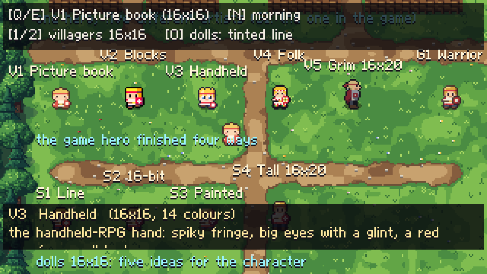
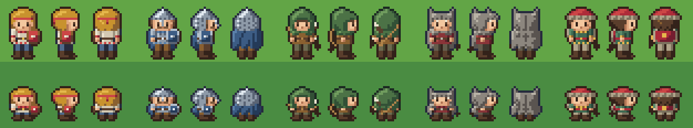

# Plac prób: wybór stylu i klimatu

Plac prób to osobna scena, w której nic się nie dzieje poza tym, że bohater chodzi. Służy do jednego: żeby postawić obok siebie
warianty bohatera, mieszkańców, potworów i scenerii, obejrzeć je w ruchu i wskazać, co zostaje. Nic stąd nie jest jeszcze
użyte w grze. To, co zostanie wybrane, przenosi się do gry. **Dopóki trwa wybieranie, nic stąd nie znika**: wcześniejsze
wersje stoją w rzędach archiwum.

## Teraz wybieramy: styl graficzny bohatera

Bohater jest jeden: ten, który jest dziś w grze (jasne włosy, czerwona krajka z końcami na wietrze, jasna koszula, czerwony
płaszcz, okrągła tarcza). Stoi na placu jako **G1**. Szukamy dla niego stylu, więc stoi obok w wielu wersjach.

### Pięciu różnych grafików (V1–V5)

Ten sam bohater narysowany od zera pięć razy, tak jak zrobiłoby to pięć różnych osób: inne proporcje, kształt głowy, oczy,
kreska i paleta.

| Kod | Styl | Rozmiar | Czyja to ręka |
|---|---|---|---|
| **V1** | Bajka | 16×16 | ilustrator książeczek: okrągła głowa, oczy-kropki, rumieńce, płaszcz jak dzwonek; pastele, brązowa kreska |
| **V2** | Klocek | 16×16 | minimalista: kanciasta głowa, oczy-kreski, twardy cień z prawej, czarny kontur; 16 barw PICO-8 |
| **V3** | Kieszonkowy | 16×16 | ręka z przenośnych RPG: nastroszona grzywka, duże niebieskie oczy z błyskiem, czerwony szal, drobne ciało |
| **V4** | Ludowy | 16×16 | wycinanka: płaskie odświętne barwy, haft na koszuli i krajce, pasiaste portki, rozeta na tarczy |
| **V5** | Surowy | 16×20 | ponury realista: mała głowa, kolczuga, płaszcz do kolan, miecz na plecach; zgaszone barwy |

### Cztery wykończenia tego samego rysunku (S1–S4)

Wcześniejsza próba: rysunek bohatera z gry wykończony na cztery sposoby. To jedna ręka, różni się kreską i cieniowaniem.

| Kod | Wykończenie | Rozmiar | Na czym polega |
|---|---|---|---|
| **S1** | Kreska | 16×16 | płaskie plamy w czarnym konturze, 7 kolorów |
| **S2** | 16 bitów | 16×16 | trzy tony na materiał, połysk na włosach, kontur w ciemnym odcieniu tego, co obrysowuje |
| **S3** | Malowany | 16×16 | bez konturu od strony światła, ciemny brzeg tylko w cieniu; miękkie barwy |
| **S4** | Wysoki 16x20 | 16×20 | wykończenie 16 bitów na 1,25 kafla |

Wszystko to jest w `src/art/heroStyles.ts` (`HERO_HANDS`, `HERO_STYLES`).

| Pięć pomysłów na bohatera, w dwóch wysokościach | Potwory według wielkości | Dwa kafle: bies i leszy |
|---|---|---|
|  |  |  |

## Wzorzec

Wzorcem wielkości i rzemiosła są 16-bitowe gry przygodowe z widokiem z góry. Bierzemy z nich miary i zasady, a nie rysunki:
postaci, potwory i świat są nasze, słowiańskie.

| Zasada | Co to znaczy u nas |
|---|---|
| wszystko żyje na siatce 16 px | kafel 16×16; postać ma 16 px szerokości |
| postać jest mała, a połowa z niej to głowa | bohater ma jeden kafel (16×16) albo półtora (16×24); głowa to 8 albo 10 wierszy |
| głowa nie jest szersza od tułowia | tułów z rękami ma szerokość głowy (11 px). Szeroka głowa na wąskim tułowiu wygląda jak żarówka |
| nic nie wystaje poza kafel | hełm, kaptur i uszy wilczej skóry są rysowane w obrębie komórki, osobno dla każdej wysokości |
| widok lekko z góry | górna część głowy to czubek (włosy, hełm), twarz siedzi nisko |
| 15 kolorów na postać | tyle mieściła jedna paleta sprite'a na konsoli 16-bitowej (16. to przezroczystość); materiały dzielą się kolorami: skóra butów, pasa i obręczy tarczy to jeden brąz, cień spodni to kolor konturu |
| kontur barwny | ludzie: kontur bierze ciemny odcień tego, co obrysowuje (ciepły przy skórze, włosach i rzemieniu, chłodny przy płótnie i stali). Potwory: jeden ciemny kontur. Klawisz **O** pozwala porównać trzy sposoby |
| trzy tony na materiał | cień, kolor, światło; światło zawsze z lewej góry |
| potwory w trzech wysokościach | jeden kafel, półtora, dwa. Nic nie jest wyższe niż dwa kafle |

Przy każdym eksponacie plac pokazuje, ile kolorów faktycznie zużywa. Dziś wszystkie postaci mieszczą się w 15.

## Jak wejść

- z ekranu tytułowego: strzałka w dół na **Plac prób**, potem Shift albo Z,
- albo wprost: `http://localhost:5173/?lab`,
- albo od razu na wybranym zestawie: `?lab&hero=V2&mood=zmierzch`
  (`hero`: kod eksponatu, np. `V2`, `S2`, `G1`, `A3`, `B5`; `size`: `small`, `tall` (wzrost mieszkańców);
  `mood`: `poranek`, `zmierzch`, `jesien`, `ponuro`, `noc`; `ink`: `tinted`, `dark`, `none`).

## Klawisze

| Klawisz | Co zmienia |
|---|---|
| WASD / strzałki | bohater chodzi |
| **Q / E** | poprzedni / następny bohater, którym się chodzi: po kolei wszyscy, od V1 do archiwum |
| **1 / 2** | wzrost mieszkańców: 16×16 albo 16×24 |
| **O** | kontur lalek (A, B, mieszkańcy): barwny / ciemny / bez konturu |
| **N** | nastrój scenerii (pora dnia, pora roku) |
| **Shift** | świat: Jawia / Nawia |
| **G** | siatka kafli 16 px |
| **T** | podpisy eksponatów |
| L / M / F | język / wyciszenie / pełny ekran |
| **Esc** | powrót do menu |

Wybrane ustawienia widać na górze ekranu. Gdy bohater stanie przy eksponacie, na dole pojawia się jego kod, nazwa,
rozmiar w pikselach, liczba kolorów i jedno zdanie o pomyśle, który za nim stoi.

## Co tam stoi

Każdy eksponat ma kod. Wystarczy napisać „bohater B1, strzyga P9, zjawa P12, sceneria: ponuro”.

| Kody | Co | Zachowanie |
|---|---|---|
| **V1–V5** | jeden bohater, pięciu różnych grafików (patrz wyżej) | obracają się; w każdą stronę najpierw stoją, potem idą w miejscu |
| **G1** | bohater, który jest dziś w grze | jak wyżej |
| **S1–S4** | rysunek z gry w czterech wykończeniach | jak wyżej |
| **A1–A5** | lalki na jeden kafel (16×16): pięć pomysłów na postać | jak wyżej |
| **B1–B5** | te same pomysły na półtora kafla (16×24) | jak wyżej |
| **G2–G4** | archiwum: pozostałe wyglądy z gry (klawisz H): Pastuszek, Góral, Wędrowiec | jak wyżej |
| **X1–X6** | archiwum: postacie ze „szkieletu” (głowa szersza od tułowia), 16×16 i 16×24 | jak wyżej |
| **Z1–Z4** | archiwum: pierwsze ręcznie rysowane zwierzęta (żmija, wilki, dzik) | chodzą tam i z powrotem |
| **N1–N4** | mieszkańcy: zielarka, starzec, gospodyni, dziecko (w wysokości wybranej klawiszem 1 / 2; dziecko ma zawsze jeden kafel) | stoją w zagrodach i obracają się |
| **P1–P16** | potwory, pogrupowane według wysokości | chodzą tam i z powrotem; ognik i morownik stoją |

Pomysły na postać z poprzedniej iteracji (lalki; ten sam numer w obu wysokościach):

| Nr | Kto | Pomysł |
|---|---|---|
| 1 | **Wojak** | chłopak ze wsi: jasne włosy do szczęki, krajka na czole, lniana koszula z czerwonym haftem przy kołnierzu, mankietach i u dołu, tarcza po ojcu |
| 2 | **Drużynnik** | człowiek księcia: szyszak z nosalem i kolczym czepcem, kolczuga, niebieski płaszcz, wąsy, tarcza z okuciem |
| 3 | **Łowca** | kaptur z pelerynką, skórzany kaftan, łuk i kołczan na plecach, miecz u pasa |
| 4 | **Wilczy kaptur** | skóra wilka na głowie i plecach: uszy na rogach, kły nad brwiami, czerwona tunika |
| 5 | **Kołpak** | czapka z futrzanym otokiem, zielona sukmana ze złotym szyciem i czerwonym pasem, tarcza zarzucona na plecy |

Dwie wysokości to osobne rysunki, nie jeden pomniejszony:

- **16×16** zajmuje dokładnie kafel, na którym stoi. To najczytelniejsze w grze (kolizje, zasięg miecza, chowanie się za drzewami
  są oczywiste) i najbliższe grom 8-bitowym. Osiem wierszy głowy, siedem ciała: koszula, pas, nogi.
- **16×24** ma głowę na wysokości kafla za sobą. Dziesięć wierszy głowy, trzynaście ciała: jest miejsce na haft, pas, płaszcz i krok.
  Tak budowano bohaterów w 16-bitowych grach przygodowych: kolizja u stóp ma nadal jeden kafel, a wyżej jest tylko obraz.

Potwory:

| Kod | Kto | Wysokość | Pomysł |
|---|---|---|---|
| P1 | Ognik | 1 kafel | błędny ogień nad bagnem; z gry, bez zmian |
| P2 | Morownik | 1 kafel | kwiat skazy; z gry, bez zmian |
| P3 | Żmija | 1 kafel (półtora długości) | pełznie esem po ziemi, łeb uniesiony; zygzak na grzbiecie |
| P4 | Wilk A: wilk szary | 1 kafel (półtora długości) | skrada się: łeb niżej łopatek, ciemny grzbiet, jasny spód, ogon w dół |
| P5 | Wilk B: wilk skazy | 1 kafel (półtora długości) | ten sam wilk, przez którego przerosła skaza: fiolet, kolce na grzbiecie, oko w kolorze Nawi |
| P6 | Dzik | 1 kafel (półtora długości) | sam kark: garb ze szczeciną, długi łeb nisko, szable, czerwone oko |
| P7 | Utopiec A: topielec | 1,5 kafla | opuchnięty trup w wodorostach, ręce do ziemi |
| P8 | Utopiec B: wodnik | 1,5 kafla | chudy, śliski, płetwy zamiast uszu |
| P9 | Strzyga A: jędza | 1,5 kafla | wychudła, zgarbiona, szpony do ziemi, włosy na twarzy |
| P10 | Strzyga B: sowa | 1,5 kafla | płaszcz z piór, dwa oczodoły ze światłem na dnie, dziób |
| P11 | Zjawa A: całun | 1,5 kafla | pusty kaptur, w środku dwa światła; rozwiewa się u dołu |
| P12 | Zjawa B: południca | 1,5 kafla | kobieta w bieli, czarne włosy na twarzy, sierp, wianek z kłosów |
| P13 | Upiór | 1,5 kafla | drużynnik, który nie odszedł: kości i rdza |
| P14 | Licho | 1,5 kafla | jedno oko, sama skóra i kości |
| P15 | Bies | 2 kafle | rogi, ogon, kopyta: stary diabeł z bagien |
| P16 | Leszy | 2 kafle | pan lasu: kora, mech, poroże, czaszka zamiast twarzy |

Zwierzęta (żmija, wilki, dzik) są rysowane ręcznie, klatka po klatce, z profilu.

## Nastroje scenerii (klawisz N)

Ta sama łąka, wieś, staw i krąg kamieni w pięciu wersjach: **poranek** (obecny wygląd gry), **zmierzch** (ciepłe światło, fioletowe
cienie), **jesień** (rdzawe liście, pożółkła trawa), **ponuro** (bez słońca, kolory wyprane) i **noc**. Postaci są podbarwiane
światłem danej pory. Prawy koniec łąki jest zarośnięty skazą, żeby było ją widać w każdym nastroju.
Nawia ma jeden wygląd: tam nie ma pogody.

## Jak są zrobione postaci

- **Ludzie** (bohater i mieszkańcy) są w całości rysowani ręcznie, jako tekst, w `src/art/dolls.ts`. Postać to „lalka z papieru”:
  ciało (osobny rysunek na każdy widok i każdy krok), na nim głowa, a pod i nad nimi to, co niesie (tarcza, płaszcz, łuk, miecz,
  fartuch, kij). Ciała są wspólne; pomysł na postać to głowa w trzech widokach, paleta i lista rzeczy. Kontur dorysowuje się sam.
- **Potwory dwunożne** składa „szkielet” (`src/art/rig.ts`): z proporcji, materiałów i dodatków robi trzy widoki
  i pięć klatek chodu.
- **Zwierzęta** są rysowane ręcznie z profilu (`src/art/cast.ts`): ciało raz, do tego trzy układy nóg. Żmija jest zadana
  kolumna po kolumnie, więc druga klatka to ten sam wąż chwilę później.

Czego jeszcze nie ma: zamachu mieczem, gardy, obrażeń, ataków potworów. Postaci na placu tylko stoją i chodzą.

## Dla developera

| Co | Gdzie |
|---|---|
| scena | `src/scenes/PlaygroundScene.ts` (miejsca eksponatów to tabele `*_SPOTS`) |
| mapa łąki | `src/lab/playground.room.txt` (zwykły plik pokoju; nie należy do świata gry) |
| style bohatera | `src/art/heroStyles.ts`: `HERO_HANDS` (V) i `HERO_STYLES` (S): głowa z tułowiem, trzy układy nóg, tarcza, paleta, sposób obrysowania; `styleFrame`, `styleSheet` |
| ludzie (lalki) | `src/art/dolls.ts`: ciała `TALL_SHIRT`, `SMALL_SHIRT`, `*_ROBE`; głowy `HEAD_*`; rzeczy (`SHIELD`, `CLOAK_*`, `BOW_*`...); `HERO_LOOKS`, `FOLK_LOOKS`; `dollFrame`, `dollSheet` |
| archiwum | `src/art/archive.ts`: wcześniejsze postacie ze szkieletu i pierwsze zwierzęta, bez zmian |
| szkielet potworów | `src/art/rig.ts`: `Figure`, `figureFrame`, `figureSheet` |
| potwory | `src/art/cast.ts`: `CREATURES`, rysunki zwierząt |
| nastroje | `MOODS` w `src/art/surface.ts` |

Litery w rysunkach ludzi znaczą wszędzie to samo (`h H l` włosy, `s S t` skóra, `a A b` koszula, `r R` haft, `p P` spodnie,
`f F` buty, `c C d` płaszcz albo kaptur, `m n M` metal...; pełna lista jest na górze `dolls.ts`), więc pod ten sam rysunek
można podłożyć inną paletę.

- **Nowy styl bohatera**: wpis w `HERO_HANDS` (albo `HERO_STYLES`): `upper` (głowa i tułów, od góry komórki), `legs` (stoi, krok, drugi krok),
  `shield` (rysunek i miejsce w każdym widoku), `pal`, `ink` (`drawn`: kontur jest w rysunku jako litera `o`; `tinted`: dorysowany
  dookoła; `rim`: dorysowany tylko z prawej i u dołu) i `line` (kolor dorysowanej kreski przy danej literze). Wysokość komórki to `fh`.
- **Wszyscy bohaterowie, którymi da się chodzić**, to jedna lista: `listCandidates()` w scenie. Kto na niej jest, ten stoi
  na łące i jest pod Q / E.
- **Nowy pomysł na postać (lalka)**: wpis w `HERO_LOOKS`: `head` (głowa: po trzy rysunki dla `tall` i `small`; 10 i 8 wierszy,
  ostatni to podbródek), `pal` (kolor każdej litery), `line` (które litery biorą ciepły kontur; reszta dostaje `pal.o`),
  `gear` (rzeczy i to, czy w danym widoku leżą pod ciałem, na nim, czy na wierzchu). `stillArm` wyłącza machanie ręką
  z tarczą w widoku z boku, `weave` zmienia literę zależnie od miejsca (oczka kolczugi).
- **Nowa rzecz** (np. włócznia): po trzy rysunki 16 px szerokości dla obu wysokości i wpis `Gear`.
- **Nowy mieszkaniec**: wpis w `FOLK_LOOKS`; `body: 'robe'` daje długą szatę albo spódnicę (litery spodni to wtedy spódnica),
  `only: 'small'` trzyma postać przy wzroście jednego kafla.
- `node` rysuje to bez przeglądarki: `dollFrame(look, size, view, pose)` zwraca `PixelBuffer`.
- **Nowy potwór dwunożny**: wpis w `CREATURES` z `tiles` (1, 1.5 albo 2) i `figure: monster({ ... })`. Dodatki w `under` / `over`
  dostają `Anchors`: gdzie jest głowa, barki, dłonie.
- **Nowe zwierzę**: rysunek 24×16 z profilu, w prawo, bez konturu (dorysuje go `inked()`), i układy nóg podmieniane
  funkcją `legs()`; wpis w `CREATURES` z `frames`.
- **Nowy nastrój**: wpis w `MOODS`: funkcja przeliczająca każdy kolor palety plus rampy podmienione w całości.
- Każdy nowy eksponat potrzebuje miejsca w `CLASS_SPOTS` (albo w `*_SPOTS` dla ludzi).

## Co dalej, gdy wybór zapadnie

1. Wybrana wysokość bohatera dostaje brakujące klatki (zamach, cios, garda) i zastępuje sprite w grze.
   Przy 16×24 trzeba sprawdzić zasięg miecza i to, jak głowa zachodzi na ściany i drzewa.
2. Wybrane potwory dostają klatki ataku i wchodzą do tabeli wrogów (`SPECS` w `src/entities/Enemy.ts`).
3. Wybrany nastrój staje się paletą gry albo jej części (np. poranek przy wsi, ponuro przy kurhanie).
4. To, co odpadło, przechodzi do `archive.ts` (nie jest kasowane, dopóki styl nie jest zamknięty), a plac prób zostaje jako narzędzie.
