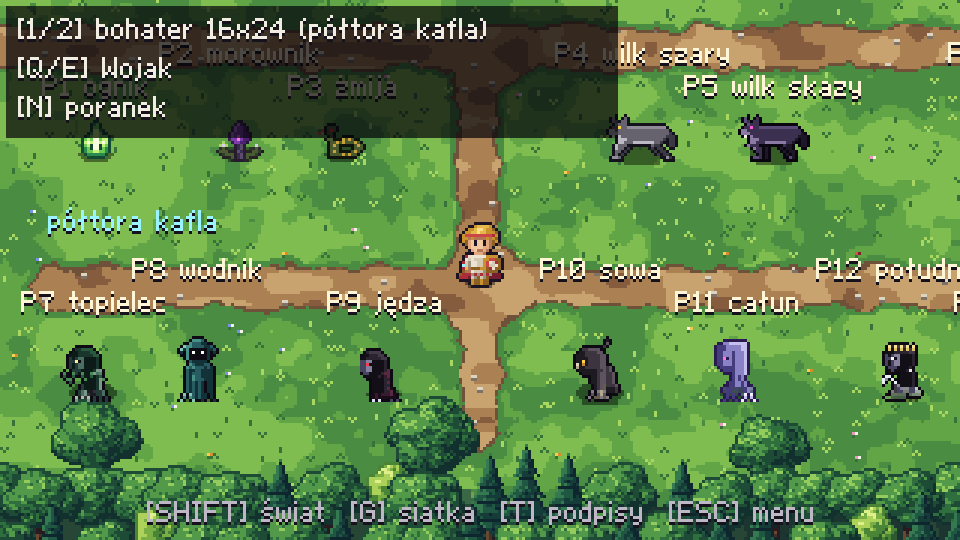
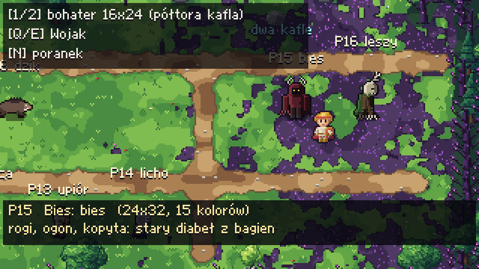

# Plac prób: wybór stylu i klimatu

Plac prób to osobna scena, w której nic się nie dzieje poza tym, że bohater chodzi. Służy do jednego: żeby postawić obok siebie
warianty bohatera, mieszkańców, potworów i scenerii, obejrzeć je w ruchu i wskazać, co zostaje. Nic stąd nie jest jeszcze
użyte w grze. To, co zostanie wybrane, przenosi się do gry; reszta znika.

| Bohater w dwóch wysokościach, mieszkańcy | Potwory według wielkości | Dwa kafle: bies i leszy |
|---|---|---|
|  |  |  |

## Wzorzec

Wzorcem wielkości i rzemiosła są 16-bitowe gry przygodowe z widokiem z góry. Bierzemy z nich miary i zasady, a nie rysunki:
postaci, potwory i świat są nasze, słowiańskie.

| Zasada | Co to znaczy u nas |
|---|---|
| wszystko żyje na siatce 16 px | kafel 16×16; postać ma 16 px szerokości |
| postać jest mała, a połowa z niej to głowa | bohater ma jeden kafel (16×16) albo półtora (16×24); głowa to 9–10 wierszy |
| widok lekko z góry | górna część głowy to czubek (włosy, hełm), twarz siedzi nisko |
| 15 kolorów na postać | tyle mieściła jedna paleta sprite'a na konsoli 16-bitowej (16. to przezroczystość); materiały dzielą się rampami: skóra butów to brąz włosów, spodnie to cień lnianej koszuli |
| jeden ciemny kontur | nie czarny: ciemna śliwka; wydaje się na niego jeden kolor |
| trzy tony na materiał | cień, kolor, światło; światło zawsze z lewej góry |
| potwory w trzech wysokościach | jeden kafel, półtora, dwa. Nic nie jest wyższe niż dwa kafle |

Przy każdym eksponacie plac pokazuje, ile kolorów faktycznie zużywa. Dziś wszystkie postaci mieszczą się w 15.

## Jak wejść

- z ekranu tytułowego: strzałka w dół na **Plac prób**, potem Shift albo Z,
- albo wprost: `http://localhost:5173/?lab`,
- albo od razu na wybranym zestawie: `?lab&size=small&hero=lowca&mood=zmierzch`
  (`size`: `small`, `tall`; `hero`: `wojak`, `druzynnik`, `lowca`; `mood`: `poranek`, `zmierzch`, `jesien`, `ponuro`, `noc`).

## Klawisze

| Klawisz | Co zmienia |
|---|---|
| WASD / strzałki | bohater chodzi |
| **1 / 2** | wysokość bohatera, którym się chodzi: 16×16 albo 16×24 (razem z nim zmieniają się mieszkańcy) |
| **Q / E** | kostium bohatera |
| **N** | nastrój scenerii (pora dnia, pora roku) |
| **Shift** | świat: Jawia / Nawia |
| **G** | siatka kafli 16 px |
| **T** | podpisy eksponatów |
| L / M / F | język / wyciszenie / pełny ekran |
| **Esc** | powrót do menu |

Wybrane ustawienia widać w lewym górnym rogu. Gdy bohater stanie przy eksponacie, na dole pojawia się jego kod, nazwa,
rozmiar w pikselach, liczba kolorów i jedno zdanie o pomyśle, który za nim stoi.

## Co tam stoi

Każdy eksponat ma kod. Wystarczy napisać „bohater B1, strzyga P9, zjawa P12, sceneria: ponuro”.

| Kody | Co | Zachowanie |
|---|---|---|
| **A1–A3** | bohater na jeden kafel (16×16): Wojak, Drużynnik, Łowca | stoją i obracają się, żeby było widać każdą stronę |
| **B1–B3** | ten sam bohater na półtora kafla (16×24) | jak wyżej |
| **N1–N4** | mieszkańcy: zielarka, starzec, gospodyni, dziecko (w wysokości wybranej klawiszem 1 / 2) | jak wyżej |
| **P1–P16** | potwory, pogrupowane według wysokości | chodzą tam i z powrotem; ognik i morownik stoją |

Dwie wysokości bohatera różnią się tylko ciałem: głowa jest ta sama, rysowana ręcznie.

- **16×16** zajmuje dokładnie kafel, na którym stoi. To najczytelniejsze w grze (kolizje, zasięg miecza, chowanie się za drzewami
  są oczywiste) i najbliższe grom 8-bitowym. Na ciało zostaje pięć wierszy: tunika, mała tarcza, stopy.
- **16×24** ma głowę na wysokości kafla za sobą. Jest miejsce na tunikę z rąbkiem, pas, płaszcz i krok. Tak budowano bohaterów
  w 16-bitowych grach przygodowych: kolizja u stóp ma nadal jeden kafel, a wyżej jest tylko obraz.

Potwory:

| Kod | Kto | Wysokość | Pomysł |
|---|---|---|---|
| P1 | Ognik | 1 kafel | błędny ogień nad bagnem; z gry, bez zmian |
| P2 | Morownik | 1 kafel | kwiat skazy; z gry, bez zmian |
| P3 | Żmija | 1 kafel | zwinięta, z uniesionym łbem; zygzak na grzbiecie |
| P4 | Wilk A: wilk szary | 1 kafel (półtora długości) | chudy, ze zwieszonym łbem, żółte oko |
| P5 | Wilk B: wilk skazy | 1 kafel (półtora długości) | ten sam wilk dotknięty skazą: fiolet i oko w kolorze Nawi |
| P6 | Dzik | 1 kafel (półtora długości) | garb ze szczeciną, łeb nisko, szable |
| P7 | Utopiec A: topielec | 1,5 kafla | opuchnięty trup w wodorostach, ręce do ziemi |
| P8 | Utopiec B: wodnik | 1,5 kafla | chudy, śliski, płetwy zamiast uszu |
| P9 | Strzyga A: jędza | 1,5 kafla | wychudła, zgarbiona, szpony do ziemi, włosy na twarzy |
| P10 | Strzyga B: sowa | 1,5 kafla | płaszcz z piór, dwa oczodoły ze światłem na dnie, dziób |
| P11 | Zjawa A: całun | 1,5 kafla | pusty kaptur, w środku dwa światła; rozwiewa się u dołu |
| P12 | Zjawa B: południca | 1,5 kafla | kobieta w bieli, czarne włosy na twarzy, sierp, wianek z kłosów |
| P13 | Upiór | 1,5 kafla | drużynnik, który nie odszedł: kości i rdza |
| P14 | Licho | 1,5 kafla | jedno oko, sama skóra i kości |
| P15 | Bies | 2 kafle | rogi, ogon, kopyta: stary diabeł z bagien |
| P16 | Leszy | 2 kafle | pan lasu: kora, mech, poroże, czaszka zamiast twarzy |

Zwierzęta (żmija, wilki, dzik) są rysowane ręcznie, klatka po klatce, z profilu.

## Nastroje scenerii (klawisz N)

Ta sama łąka, wieś, staw i krąg kamieni w pięciu wersjach: **poranek** (obecny wygląd gry), **zmierzch** (ciepłe światło, fioletowe
cienie), **jesień** (rdzawe liście, pożółkła trawa), **ponuro** (bez słońca, kolory wyprane) i **noc**. Postaci są podbarwiane
światłem danej pory. Prawy koniec łąki jest zarośnięty skazą, żeby było ją widać w każdym nastroju.
Nawia ma jeden wygląd: tam nie ma pogody.

## Jak są zrobione postaci

- **Głowy ludzi** są rysowane ręcznie (12×10 pikseli, trzy widoki) w `src/art/cast.ts`, jako tekst. To, co na głowie
  (szyszak, kaptur, chusta, broda), to osobne rysunki nakładane na głowę.
- **Ciała ludzi i potwory dwunożne** składa „szkielet” (`src/art/rig.ts`): z proporcji, materiałów i dodatków robi trzy widoki
  i pięć klatek chodu. Jeden opis daje od razu wszystkie kierunki.
- **Zwierzęta** są w całości rysowane ręcznie: ciało raz, do tego trzy układy nóg.

Czego jeszcze nie ma: zamachu mieczem, gardy, obrażeń, ataków potworów. Postaci na placu tylko stoją i chodzą.

## Dla developera

| Co | Gdzie |
|---|---|
| scena | `src/scenes/PlaygroundScene.ts` (miejsca eksponatów to tabele `*_SPOTS`) |
| mapa łąki | `src/lab/playground.room.txt` (zwykły plik pokoju; nie należy do świata gry) |
| szkielet postaci | `src/art/rig.ts`: `Figure`, `figureFrame`, `figureSheet` |
| obsada | `src/art/cast.ts`: `BUILDS` (dwie wysokości), `HEAD` i nakrycia głowy, `HEROES`, `FOLK_CAST`, `CREATURES` |
| nastroje | `MOODS` w `src/art/surface.ts` |

- **Nowy kostium bohatera**: wpis w `HEROES` (`person(build, { ... })`): rampa włosów, `band`, `cloak`, `shield`,
  a w `over` to, co ma na głowie i przy pasie (`helmet`, `hood`, `bandTail`, `sword`). `person()` pilnuje budżetu kolorów:
  buty, pas i obręcz tarczy biorą brąz z włosów, spodnie cień z lnu.
- **Nowe nakrycie głowy**: trzy rysunki 12 px szerokości (przód, tył, bok) i `worn(rysunki, paleta, przesunięcie)`.
- **Nowy potwór dwunożny**: wpis w `CREATURES` z `tiles` (1, 1.5 albo 2) i `figure: monster({ ... })`. Dodatki w `under` / `over`
  dostają `Anchors`: gdzie jest głowa, barki, dłonie.
- **Nowe zwierzę**: rysunek 24×16 z profilu, w prawo, i układy nóg podmieniane funkcją `legs()`; wpis w `CREATURES` z `frames`.
- **Nowy nastrój**: wpis w `MOODS`: funkcja przeliczająca każdy kolor palety plus rampy podmienione w całości.
- Każdy nowy eksponat potrzebuje miejsca w `CLASS_SPOTS` (albo w `*_SPOTS` dla ludzi).

## Co dalej, gdy wybór zapadnie

1. Wybrana wysokość bohatera dostaje brakujące klatki (zamach, cios, garda) i zastępuje sprite w grze.
   Przy 16×24 trzeba sprawdzić zasięg miecza i to, jak głowa zachodzi na ściany i drzewa.
2. Wybrane potwory dostają klatki ataku i wchodzą do tabeli wrogów (`SPECS` w `src/entities/Enemy.ts`).
3. Wybrany nastrój staje się paletą gry albo jej części (np. poranek przy wsi, ponuro przy kurhanie).
4. To, co odpadło, jest usuwane z `cast.ts`, a plac prób zostaje jako narzędzie.
